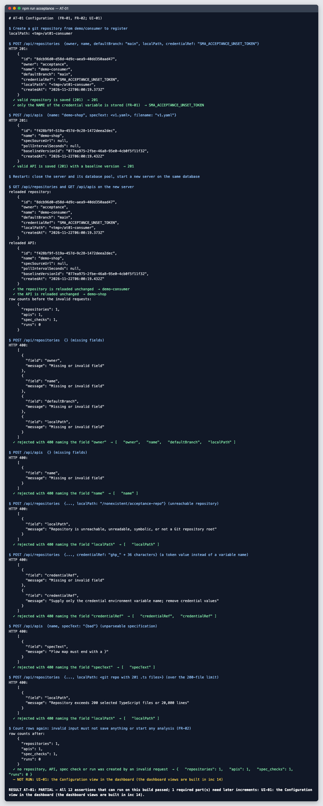

# AT-01 — Configuration

**Result: PARTIAL.** All 12 assertions that can run on this build passed; 1 required part(s) need later increments: UI-01: the Configuration view in the dashboard (the dashboard views are built in inc 14).

<!-- Generated by `npm run acceptance` (scripts/acceptance/run.ts). Do not edit by hand. -->

| Field | Value |
| --- | --- |
| Requirements | FR-01, FR-02; UI-01 |
| SRS procedure (Appendix A) | Save and reload a valid configuration. Reject missing fields, an unreachable repository, an unparseable specification, and a repository over the size limits. |
| Build | commit `06d0e7939ead` on branch `feat/inc17a-early-deliverables` (clean working tree apart from docs/acceptance) |
| Run at | 2026-11-22T06:00:19.224Z (took 0.4 s) |
| Environment | macOS 26.6, Darwin 25.6.0 (arm64); Node v22.19.0; Docker 29.9.2; PostgreSQL 16.15 (Debian 16.15-1.pgdg13+2); oasdiff 1.35.0 |
| Database | `sma_acceptance_test`, dropped, re-created and migrated at the start of the run |
| Re-run | `npm run acceptance` |

## Inputs

- A git repository copied from `demo/consumer` (branch `main`).
- The Demo Shop v1 spec, `demo/api/specs/v1.yaml`.
- Invalid inputs: empty bodies, a `localPath` that does not exist, a token value in `credentialRef`, the spec text `{bad`, and a git repository with 201 TypeScript files.

## Steps actually run

1. Create a git repository from demo/consumer to register
2. POST /api/repositories  {owner, name, defaultBranch: "main", localPath, credentialRef: "SMA_ACCEPTANCE_UNSET_TOKEN"}
3. POST /api/apis  {name: "demo-shop", specText: <v1.yaml>, filename: "v1.yaml"}
4. Restart: close the server and its database pool, start a new server on the same database
5. GET /api/repositories and GET /api/apis on the new server
6. POST /api/repositories  {} (missing fields)
7. POST /api/apis  {} (missing fields)
8. POST /api/repositories  {..., localPath: "/nonexistent/acceptance-repo"} (unreachable repository)
9. POST /api/repositories  {..., credentialRef: "ghp_" + 36 characters} (a token value instead of a variable name)
10. POST /api/apis  {name, specText: "{bad"} (unparseable specification)
11. POST /api/repositories  {..., localPath: <git repo with 201 .ts files>} (over the 200-file limit)
12. Count rows again: invalid input must not save anything or start any analysis (FR-02)

## Actual output

Full transcript: [output/AT-01.txt](output/AT-01.txt).

Terminal screenshot (the transcript rendered as a terminal window; dashboard screenshots come with inc 14):



```text
# AT-01 Configuration  (FR-01, FR-02; UI-01)

$ Create a git repository from demo/consumer to register
localPath: <tmp>/at01-consumer

$ POST /api/repositories  {owner, name, defaultBranch: "main", localPath, credentialRef: "SMA_ACCEPTANCE_UNSET_TOKEN"}
HTTP 201:
    {
      "id": "8dcb96d0-d58d-4d9c-aea9-40dd350aad47",
      "owner": "acceptance",
      "name": "demo-consumer",
      "defaultBranch": "main",
      "credentialRef": "SMA_ACCEPTANCE_UNSET_TOKEN",
      "localPath": "<tmp>/at01-consumer",
      "createdAt": "2026-11-22T06:00:19.373Z"
    }
  ✓ valid repository is saved (201)  → 201
  ✓ only the NAME of the credential variable is stored (FR-01)  → SMA_ACCEPTANCE_UNSET_TOKEN

$ POST /api/apis  {name: "demo-shop", specText: <v1.yaml>, filename: "v1.yaml"}
HTTP 201:
    {
      "id": "f428bf9f-519a-457d-9c28-1472deea2dec",
      "name": "demo-shop",
      "specSourceUrl": null,
      "pollIntervalSeconds": null,
      "baselineVersionId": "077ea975-2fbe-46a8-95e0-4cb0f5f11f32",
      "createdAt": "2026-11-22T06:00:19.432Z"
    }
  ✓ valid API is saved (201) with a baseline version  → 201

$ Restart: close the server and its database pool, start a new server on the same database

$ GET /api/repositories and GET /api/apis on the new server
reloaded repository:
    {
      "id": "8dcb96d0-d58d-4d9c-aea9-40dd350aad47",
      "owner": "acceptance",
      "name": "demo-consumer",
      "defaultBranch": "main",
      "credentialRef": "SMA_ACCEPTANCE_UNSET_TOKEN",
      "localPath": "<tmp>/at01-consumer",
      "createdAt": "2026-11-22T06:00:19.373Z"
    }
reloaded API:
    {
      "id": "f428bf9f-519a-457d-9c28-1472deea2dec",
      "name": "demo-shop",
      "specSourceUrl": null,
      "pollIntervalSeconds": null,
      "baselineVersionId": "077ea975-2fbe-46a8-95e0-4cb0f5f11f32",
      "createdAt": "2026-11-22T06:00:19.432Z"
    }
  ✓ the repository is reloaded unchanged  → demo-consumer
  ✓ the API is reloaded unchanged  → demo-shop
row counts before the invalid requests:
    {
      "repositories": 1,
      "apis": 1,
      "spec_checks": 1,
      "runs": 0
    }

$ POST /api/repositories  {} (missing fields)
HTTP 400:
    [
      {
        "field": "owner",
        "message": "Missing or invalid field"
      },
      {
        "field": "name",
        "message": "Missing or invalid field"
      },
      {
        "field": "defaultBranch",
        "message": "Missing or invalid field"
      },
      {
        "field": "localPath",
        "message": "Missing or invalid field"
      }
    ]
  ✓ rejected with 400 naming the field "owner"  → [   "owner",   "name",   "defaultBranch",   "localPath" ]

$ POST /api/apis  {} (missing fields)
HTTP 400:
    [
      {
        "field": "name",
        "message": "Missing or invalid field"
      }
    ]
  ✓ rejected with 400 naming the field "name"  → [   "name" ]

$ POST /api/repositories  {..., localPath: "/nonexistent/acceptance-repo"} (unreachable repository)
HTTP 400:
    [
      {
        "field": "localPath",
        "message": "Repository is unreachable, unreadable, symbolic, or not a Git repository root"
      }
    ]
  ✓ rejected with 400 naming the field "localPath"  → [   "localPath" ]

$ POST /api/repositories  {..., credentialRef: "ghp_" + 36 characters} (a token value instead of a variable name)
HTTP 400:
    [
      {
        "field": "credentialRef",
        "message": "Missing or invalid field"
      },
      {
        "field": "credentialRef",
        "message": "Supply only the credential environment variable name; remove credential values"
      }
    ]
  ✓ rejected with 400 naming the field "credentialRef"  → [   "credentialRef",   "credentialRef" ]

$ POST /api/apis  {name, specText: "{bad"} (unparseable specification)
HTTP 400:
    [
      {
        "field": "specText",
        "message": "Flow map must end with a }"
      }
    ]
  ✓ rejected with 400 naming the field "specText"  → [   "specText" ]

$ POST /api/repositories  {..., localPath: <git repo with 201 .ts files>} (over the 200-file limit)
HTTP 400:
    [
      {
        "field": "localPath",
        "message": "Repository exceeds 200 selected TypeScript files or 20,000 lines"
      }
    ]
  ✓ rejected with 400 naming the field "localPath"  → [   "localPath" ]

$ Count rows again: invalid input must not save anything or start any analysis (FR-02)
row counts after:
    {
      "repositories": 1,
      "apis": 1,
      "spec_checks": 1,
      "runs": 0
    }
  ✓ no repository, API, spec check or run was created by an invalid request  → {   "repositories": 1,   "apis": 1,   "spec_checks": 1,   "runs": 0 }
  – NOT RUN: UI-01: the Configuration view in the dashboard (the dashboard views are built in inc 14)

RESULT AT-01: PARTIAL — All 12 assertions that can run on this build passed; 1 required part(s) need later increments: UI-01: the Configuration view in the dashboard (the dashboard views are built in inc 14).
```

## Not run on this build

- UI-01: the Configuration view in the dashboard: the dashboard views are built in inc 14.

## Result

**PARTIAL.** All 12 assertions that can run on this build passed; 1 required part(s) need later increments: UI-01: the Configuration view in the dashboard (the dashboard views are built in inc 14).
