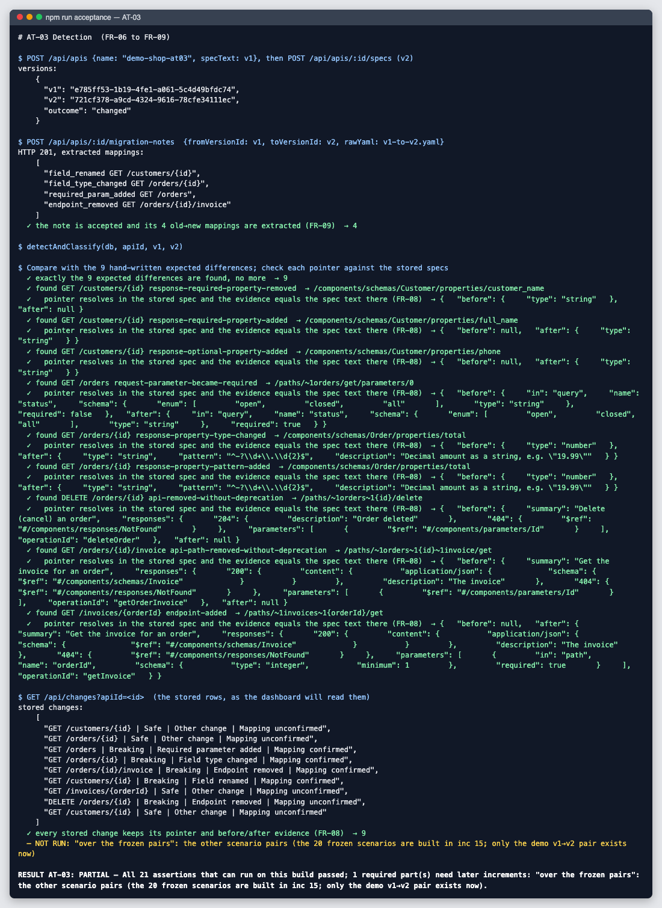

# AT-03 — Detection

**Result: PARTIAL.** All 21 assertions that can run on this build passed; 1 required part(s) need later increments: "over the frozen pairs": the other scenario pairs (the 20 frozen scenarios are built in inc 15; only the demo v1→v2 pair exists now).

<!-- Generated by `npm run acceptance` (scripts/acceptance/run.ts). Do not edit by hand. -->

| Field | Value |
| --- | --- |
| Requirements | FR-06 to FR-09 |
| SRS procedure (Appendix A) | Over the frozen pairs, verify every expected difference is found with its path, method, and pointer, and that evidence is retained. |
| Build | commit `06d0e7939ead` on branch `feat/inc17a-early-deliverables` (clean working tree apart from docs/acceptance) |
| Run at | 2026-11-22T06:00:19.224Z (took 0.1 s) |
| Environment | macOS 26.6, Darwin 25.6.0 (arm64); Node v22.19.0; Docker 29.9.2; PostgreSQL 16.15 (Debian 16.15-1.pgdg13+2); oasdiff 1.35.0 |
| Database | `sma_acceptance_test`, dropped, re-created and migrated at the start of the run |
| Re-run | `npm run acceptance` |

## Inputs

- `demo/api/specs/v1.yaml` → `demo/api/specs/v2.yaml` (the only spec pair that exists before inc 15).
- The migration note `demo/api/migration-notes/v1-to-v2.yaml`.
- Hand-written expected differences: `DEMO_V1_V2` in `scripts/acceptance/expected.ts`.

## Steps actually run

1. POST /api/apis {name: "demo-shop-at03", specText: v1}, then POST /api/apis/:id/specs (v2)
2. POST /api/apis/:id/migration-notes  {fromVersionId: v1, toVersionId: v2, rawYaml: v1-to-v2.yaml}
3. detectAndClassify(db, apiId, v1, v2)
4. Compare with the 9 hand-written expected differences; check each pointer against the stored specs
5. GET /api/changes?apiId=<id>  (the stored rows, as the dashboard will read them)

## Actual output

Full transcript: [output/AT-03.txt](output/AT-03.txt).

Terminal screenshot (the transcript rendered as a terminal window; dashboard screenshots come with inc 14):



```text
# AT-03 Detection  (FR-06 to FR-09)

$ POST /api/apis {name: "demo-shop-at03", specText: v1}, then POST /api/apis/:id/specs (v2)
versions:
    {
      "v1": "e785ff53-1b19-4fe1-a061-5c4d49bfdc74",
      "v2": "721cf378-a9cd-4324-9616-78cfe34111ec",
      "outcome": "changed"
    }

$ POST /api/apis/:id/migration-notes  {fromVersionId: v1, toVersionId: v2, rawYaml: v1-to-v2.yaml}
HTTP 201, extracted mappings:
    [
      "field_renamed GET /customers/{id}",
      "field_type_changed GET /orders/{id}",
      "required_param_added GET /orders",
      "endpoint_removed GET /orders/{id}/invoice"
    ]
  ✓ the note is accepted and its 4 old→new mappings are extracted (FR-09)  → 4

$ detectAndClassify(db, apiId, v1, v2)

$ Compare with the 9 hand-written expected differences; check each pointer against the stored specs
  ✓ exactly the 9 expected differences are found, no more  → 9
  ✓ found GET /customers/{id} response-required-property-removed  → /components/schemas/Customer/properties/customer_name
  ✓   pointer resolves in the stored spec and the evidence equals the spec text there (FR-08)  → {   "before": {     "type": "string"   },   "after": null }
  ✓ found GET /customers/{id} response-required-property-added  → /components/schemas/Customer/properties/full_name
  ✓   pointer resolves in the stored spec and the evidence equals the spec text there (FR-08)  → {   "before": null,   "after": {     "type": "string"   } }
  ✓ found GET /customers/{id} response-optional-property-added  → /components/schemas/Customer/properties/phone
  ✓   pointer resolves in the stored spec and the evidence equals the spec text there (FR-08)  → {   "before": null,   "after": {     "type": "string"   } }
  ✓ found GET /orders request-parameter-became-required  → /paths/~1orders/get/parameters/0
  ✓   pointer resolves in the stored spec and the evidence equals the spec text there (FR-08)  → {   "before": {     "in": "query",     "name": "status",     "schema": {       "enum": [         "open",         "closed",         "all"       ],       "type": "string"     },     "required": false   },   "after": {     "in": "query",     "name": "status",     "schema": {       "enum": [         "open",         "closed",         "all"       ],       "type": "string"     },     "required": true   } }
  ✓ found GET /orders/{id} response-property-type-changed  → /components/schemas/Order/properties/total
  ✓   pointer resolves in the stored spec and the evidence equals the spec text there (FR-08)  → {   "before": {     "type": "number"   },   "after": {     "type": "string",     "pattern": "^-?\\d+\\.\\d{2}$",     "description": "Decimal amount as a string, e.g. \"19.99\""   } }
  ✓ found GET /orders/{id} response-property-pattern-added  → /components/schemas/Order/properties/total
  ✓   pointer resolves in the stored spec and the evidence equals the spec text there (FR-08)  → {   "before": {     "type": "number"   },   "after": {     "type": "string",     "pattern": "^-?\\d+\\.\\d{2}$",     "description": "Decimal amount as a string, e.g. \"19.99\""   } }
  ✓ found DELETE /orders/{id} api-removed-without-deprecation  → /paths/~1orders~1{id}/delete
  ✓   pointer resolves in the stored spec and the evidence equals the spec text there (FR-08)  → {   "before": {     "summary": "Delete (cancel) an order",     "responses": {       "204": {         "description": "Order deleted"       },       "404": {         "$ref": "#/components/responses/NotFound"       }     },     "parameters": [       {         "$ref": "#/components/parameters/Id"       }     ],     "operationId": "deleteOrder"   },   "after": null }
  ✓ found GET /orders/{id}/invoice api-path-removed-without-deprecation  → /paths/~1orders~1{id}~1invoice/get
  ✓   pointer resolves in the stored spec and the evidence equals the spec text there (FR-08)  → {   "before": {     "summary": "Get the invoice for an order",     "responses": {       "200": {         "content": {           "application/json": {             "schema": {               "$ref": "#/components/schemas/Invoice"             }           }         },         "description": "The invoice"       },       "404": {         "$ref": "#/components/responses/NotFound"       }     },     "parameters": [       {         "$ref": "#/components/parameters/Id"       }     ],     "operationId": "getOrderInvoice"   },   "after": null }
  ✓ found GET /invoices/{orderId} endpoint-added  → /paths/~1invoices~1{orderId}/get
  ✓   pointer resolves in the stored spec and the evidence equals the spec text there (FR-08)  → {   "before": null,   "after": {     "summary": "Get the invoice for an order",     "responses": {       "200": {         "content": {           "application/json": {             "schema": {               "$ref": "#/components/schemas/Invoice"             }           }         },         "description": "The invoice"       },       "404": {         "$ref": "#/components/responses/NotFound"       }     },     "parameters": [       {         "in": "path",         "name": "orderId",         "schema": {           "type": "integer",           "minimum": 1         },         "required": true       }     ],     "operationId": "getInvoice"   } }

$ GET /api/changes?apiId=<id>  (the stored rows, as the dashboard will read them)
stored changes:
    [
      "GET /customers/{id} | Safe | Other change | Mapping unconfirmed",
      "GET /orders/{id} | Safe | Other change | Mapping unconfirmed",
      "GET /orders | Breaking | Required parameter added | Mapping confirmed",
      "GET /orders/{id} | Breaking | Field type changed | Mapping confirmed",
      "GET /orders/{id}/invoice | Breaking | Endpoint removed | Mapping confirmed",
      "GET /customers/{id} | Breaking | Field renamed | Mapping confirmed",
      "GET /invoices/{orderId} | Safe | Other change | Mapping unconfirmed",
      "DELETE /orders/{id} | Breaking | Endpoint removed | Mapping unconfirmed",
      "GET /customers/{id} | Safe | Other change | Mapping unconfirmed"
    ]
  ✓ every stored change keeps its pointer and before/after evidence (FR-08)  → 9
  – NOT RUN: "over the frozen pairs": the other scenario pairs (the 20 frozen scenarios are built in inc 15; only the demo v1→v2 pair exists now)

RESULT AT-03: PARTIAL — All 21 assertions that can run on this build passed; 1 required part(s) need later increments: "over the frozen pairs": the other scenario pairs (the 20 frozen scenarios are built in inc 15; only the demo v1→v2 pair exists now).
```

## Not run on this build

- "over the frozen pairs": the other scenario pairs: the 20 frozen scenarios are built in inc 15; only the demo v1→v2 pair exists now.

## Result

**PARTIAL.** All 21 assertions that can run on this build passed; 1 required part(s) need later increments: "over the frozen pairs": the other scenario pairs (the 20 frozen scenarios are built in inc 15; only the demo v1→v2 pair exists now).
