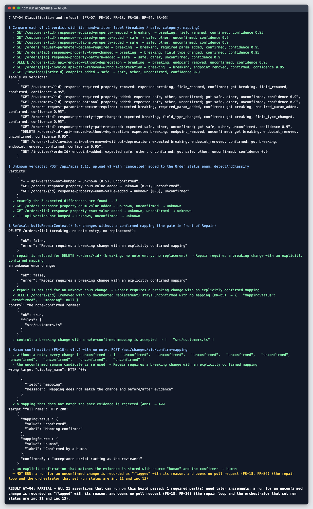

# AT-04 — Classification and refusal

**Result: PARTIAL.** All 21 assertions that can run on this build passed; 1 required part(s) need later increments: a run for an unconfirmed change is recorded as "flagged" with its reason, and opens no pull request (FR-18, FR-36) (the repair loop and the orchestrator that set run status are inc 11 and inc 13).

<!-- Generated by `npm run acceptance` (scripts/acceptance/run.ts). Do not edit by hand. -->

| Field | Value |
| --- | --- |
| Requirements | FR-07, FR-10, FR-18, FR-36; BR-04, BR-05 |
| SRS procedure (Appendix A) | Verify breaking, safe, and unknown verdicts against hand-written labels. Verify that a change with no confirmed mapping is flagged and never enters repair. |
| Build | commit `06d0e7939ead` on branch `feat/inc17a-early-deliverables` (clean working tree apart from docs/acceptance) |
| Run at | 2026-11-22T06:00:19.224Z (took 0.2 s) |
| Environment | macOS 26.6, Darwin 25.6.0 (arm64); Node v22.19.0; Docker 29.9.2; PostgreSQL 16.15 (Debian 16.15-1.pgdg13+2); oasdiff 1.35.0 |
| Database | `sma_acceptance_test`, dropped, re-created and migrated at the start of the run |
| Re-run | `npm run acceptance` |

## Inputs

- The classified v1→v2 changes from AT-03 (with the migration note).
- v1 → v1 with `cancelled` added to the Order status enum (made in memory from v1.yaml).
- v1 → v2 with no migration note (for a human confirmation).
- Hand-written labels: `DEMO_V1_V2` and `DEMO_V1_ENUM` in `scripts/acceptance/expected.ts`.

## Steps actually run

1. Compare each v1→v2 verdict with its hand-written label (breaking / safe, category, mapping)
2. Unknown verdicts: POST /api/apis (v1), upload v1 with `cancelled` added to the Order status enum, detectAndClassify
3. Refusal: buildRepairContext() for changes without a confirmed mapping (the gate in front of Repair)
4. Human confirmation (FR-10): v1→v2 with no note, POST /api/changes/:id/confirm-mapping

## Actual output

Full transcript: [output/AT-04.txt](output/AT-04.txt).

Terminal screenshot (the transcript rendered as a terminal window; dashboard screenshots come with inc 14):



```text
# AT-04 Classification and refusal  (FR-07, FR-10, FR-18, FR-36; BR-04, BR-05)

$ Compare each v1→v2 verdict with its hand-written label (breaking / safe, category, mapping)
  ✓ GET /customers/{id} response-required-property-removed → breaking  → breaking, field_renamed, confirmed, confidence 0.95
  ✓ GET /customers/{id} response-required-property-added → safe  → safe, other, unconfirmed, confidence 0.9
  ✓ GET /customers/{id} response-optional-property-added → safe  → safe, other, unconfirmed, confidence 0.9
  ✓ GET /orders request-parameter-became-required → breaking  → breaking, required_param_added, confirmed, confidence 0.95
  ✓ GET /orders/{id} response-property-type-changed → breaking  → breaking, field_type_changed, confirmed, confidence 0.95
  ✓ GET /orders/{id} response-property-pattern-added → safe  → safe, other, unconfirmed, confidence 0.9
  ✓ DELETE /orders/{id} api-removed-without-deprecation → breaking  → breaking, endpoint_removed, unconfirmed, confidence 0.95
  ✓ GET /orders/{id}/invoice api-path-removed-without-deprecation → breaking  → breaking, endpoint_removed, confirmed, confidence 0.95
  ✓ GET /invoices/{orderId} endpoint-added → safe  → safe, other, unconfirmed, confidence 0.9
labels vs verdicts:
    [
      "GET /customers/{id} response-required-property-removed: expected breaking, field_renamed, confirmed; got breaking, field_renamed, confirmed, confidence 0.95",
      "GET /customers/{id} response-required-property-added: expected safe, other, unconfirmed; got safe, other, unconfirmed, confidence 0.9",
      "GET /customers/{id} response-optional-property-added: expected safe, other, unconfirmed; got safe, other, unconfirmed, confidence 0.9",
      "GET /orders request-parameter-became-required: expected breaking, required_param_added, confirmed; got breaking, required_param_added, confirmed, confidence 0.95",
      "GET /orders/{id} response-property-type-changed: expected breaking, field_type_changed, confirmed; got breaking, field_type_changed, confirmed, confidence 0.95",
      "GET /orders/{id} response-property-pattern-added: expected safe, other, unconfirmed; got safe, other, unconfirmed, confidence 0.9",
      "DELETE /orders/{id} api-removed-without-deprecation: expected breaking, endpoint_removed, unconfirmed; got breaking, endpoint_removed, unconfirmed, confidence 0.95",
      "GET /orders/{id}/invoice api-path-removed-without-deprecation: expected breaking, endpoint_removed, confirmed; got breaking, endpoint_removed, confirmed, confidence 0.95",
      "GET /invoices/{orderId} endpoint-added: expected safe, other, unconfirmed; got safe, other, unconfirmed, confidence 0.9"
    ]

$ Unknown verdicts: POST /api/apis (v1), upload v1 with `cancelled` added to the Order status enum, detectAndClassify
verdicts:
    [
      "- - api-version-not-bumped → unknown (0.5), unconfirmed",
      "GET /orders response-property-enum-value-added → unknown (0.5), unconfirmed",
      "GET /orders/{id} response-property-enum-value-added → unknown (0.5), unconfirmed"
    ]
  ✓ exactly the 3 expected differences are found  → 3
  ✓ GET /orders response-property-enum-value-added → unknown, unconfirmed  → unknown
  ✓ GET /orders/{id} response-property-enum-value-added → unknown, unconfirmed  → unknown
  ✓ - - api-version-not-bumped → unknown, unconfirmed  → unknown

$ Refusal: buildRepairContext() for changes without a confirmed mapping (the gate in front of Repair)
DELETE /orders/{id} (breaking, no note entry, no replacement):
    {
      "ok": false,
      "error": "Repair requires a breaking change with an explicitly confirmed mapping"
    }
  ✓ repair is refused for DELETE /orders/{id} (breaking, no note entry, no replacement)  → Repair requires a breaking change with an explicitly confirmed mapping
an unknown enum change:
    {
      "ok": false,
      "error": "Repair requires a breaking change with an explicitly confirmed mapping"
    }
  ✓ repair is refused for an unknown enum change  → Repair requires a breaking change with an explicitly confirmed mapping
  ✓ DELETE /orders/{id} (removed with no documented replacement) stays unconfirmed with no mapping (BR-05)  → {   "mappingStatus": "unconfirmed",   "mapping": null }
control: the note-confirmed rename:
    {
      "ok": true,
      "files": [
        "src/customers.ts"
      ]
    }
  ✓ control: a breaking change with a note-confirmed mapping is accepted  → [   "src/customers.ts" ]

$ Human confirmation (FR-10): v1→v2 with no note, POST /api/changes/:id/confirm-mapping
  ✓ without a note, every change is unconfirmed  → [   "unconfirmed",   "unconfirmed",   "unconfirmed",   "unconfirmed",   "unconfirmed",   "unconfirmed",   "unconfirmed",   "unconfirmed",   "unconfirmed" ]
  ✓ the unconfirmed rename candidate is refused  → Repair requires a breaking change with an explicitly confirmed mapping
wrong target "display_name": HTTP 400:
    [
      {
        "field": "mapping",
        "message": "Mapping does not match the change and before/after evidence"
      }
    ]
  ✓ a mapping that does not match the spec evidence is rejected (400)  → 400
target "full_name": HTTP 200:
    {
      "mappingStatus": {
        "value": "confirmed",
        "label": "Mapping confirmed"
      },
      "mappingSource": {
        "value": "human",
        "label": "Confirmed by a human"
      },
      "confirmedBy": "acceptance script (acting as the reviewer)"
    }
  ✓ an explicit confirmation that matches the evidence is stored with source "human" and the confirmer  → human
  – NOT RUN: a run for an unconfirmed change is recorded as "flagged" with its reason, and opens no pull request (FR-18, FR-36) (the repair loop and the orchestrator that set run status are inc 11 and inc 13)

RESULT AT-04: PARTIAL — All 21 assertions that can run on this build passed; 1 required part(s) need later increments: a run for an unconfirmed change is recorded as "flagged" with its reason, and opens no pull request (FR-18, FR-36) (the repair loop and the orchestrator that set run status are inc 11 and inc 13).
```

## Not run on this build

- a run for an unconfirmed change is recorded as "flagged" with its reason, and opens no pull request (FR-18, FR-36): the repair loop and the orchestrator that set run status are inc 11 and inc 13.

## Result

**PARTIAL.** All 21 assertions that can run on this build passed; 1 required part(s) need later increments: a run for an unconfirmed change is recorded as "flagged" with its reason, and opens no pull request (FR-18, FR-36) (the repair loop and the orchestrator that set run status are inc 11 and inc 13).
