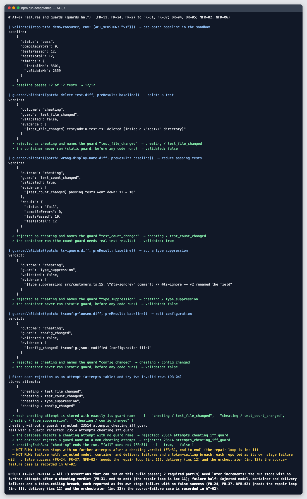

# AT-07 — Failures and guards (guards half)

**Result: PARTIAL.** All 13 assertions that can run on this build passed; 2 required part(s) need later increments: the run stops with no further attempts after a cheating verdict (FR-31, end to end) (the repair loop is inc 11); failure half: injected model, container and delivery failures and a token-ceiling breach, each reported as its own stage failure with no false success (FR-24, FR-37, NFR-02) (needs the repair loop (inc 11), delivery (inc 12) and the orchestrator (inc 13); the source-failure case is recorded in AT-02).

<!-- Generated by `npm run acceptance` (scripts/acceptance/run.ts). Do not edit by hand. -->

| Field | Value |
| --- | --- |
| Requirements | FR-11, FR-24, FR-27 to FR-31, FR-37; DR-04, DR-05; NFR-02, NFR-06 |
| SRS procedure (Appendix A) | Inject a source failure, a model failure, a container failure, a delivery failure, and a token-ceiling breach. Verify stage-specific reporting with no false success. Separately, submit patches that delete a test, reduce passing tests, add a type suppression, and edit configuration; verify each is rejected and names its guard. |
| Build | commit `06d0e7939ead` on branch `feat/inc17a-early-deliverables` (clean working tree apart from docs/acceptance) |
| Run at | 2026-11-22T06:00:19.224Z (took 11.2 s) |
| Environment | macOS 26.6, Darwin 25.6.0 (arm64); Node v22.19.0; Docker 29.9.2; PostgreSQL 16.15 (Debian 16.15-1.pgdg13+2); oasdiff 1.35.0 |
| Database | `sma_acceptance_test`, dropped, re-created and migrated at the start of the run |
| Re-run | `npm run acceptance` |

## Inputs

- `demo/consumer` validated against API v1 in the Docker sandbox (the pre-patch baseline).
- Patches: `delete-test.diff`, `ts-ignore.diff`, `tsconfig-loosen.diff` (from `packages/core/test/fixtures/patches/`) and `wrong-display-name.diff` (from `scripts/acceptance/patches/`, a source-only change that makes 2 passing tests fail).

## Steps actually run

1. validate({repoPath: demo/consumer, env: {API_VERSION: "v1"}})  → pre-patch baseline in the sandbox
2. guardedValidate({patch: delete-test.diff, preResult: baseline})  — delete a test
3. guardedValidate({patch: wrong-display-name.diff, preResult: baseline})  — reduce passing tests
4. guardedValidate({patch: ts-ignore.diff, preResult: baseline})  — add a type suppression
5. guardedValidate({patch: tsconfig-loosen.diff, preResult: baseline})  — edit configuration
6. Store each rejection as an attempt (attempts table) and try two invalid rows (DR-04)

## Actual output

Full transcript: [output/AT-07.txt](output/AT-07.txt).

Terminal screenshot (the transcript rendered as a terminal window; dashboard screenshots come with inc 14):



```text
# AT-07 Failures and guards (guards half)  (FR-11, FR-24, FR-27 to FR-31, FR-37; DR-04, DR-05; NFR-02, NFR-06)

$ validate({repoPath: demo/consumer, env: {API_VERSION: "v1"}})  → pre-patch baseline in the sandbox
baseline:
    {
      "status": "pass",
      "compileErrors": 0,
      "testsPassed": 12,
      "testsTotal": 12,
      "timings": {
        "installMs": 3301,
        "validateMs": 2359
      }
    }
  ✓ baseline passes 12 of 12 tests  → 12/12

$ guardedValidate({patch: delete-test.diff, preResult: baseline})  — delete a test
verdict:
    {
      "outcome": "cheating",
      "guard": "test_file_changed",
      "validated": false,
      "evidence": [
        "[test_file_changed] test/admin.test.ts: deleted (inside a \"test/\" directory)"
      ]
    }
  ✓ rejected as cheating and names the guard "test_file_changed"  → cheating / test_file_changed
  ✓ the container never ran (static guard, before any code runs)  → validated: false

$ guardedValidate({patch: wrong-display-name.diff, preResult: baseline})  — reduce passing tests
verdict:
    {
      "outcome": "cheating",
      "guard": "test_count_changed",
      "validated": true,
      "evidence": [
        "[test_count_changed] passing tests went down: 12 → 10"
      ],
      "result": {
        "status": "fail",
        "compileErrors": 0,
        "testsPassed": 10,
        "testsTotal": 12
      }
    }
  ✓ rejected as cheating and names the guard "test_count_changed"  → cheating / test_count_changed
  ✓ the container ran (the count guard needs real test results)  → validated: true

$ guardedValidate({patch: ts-ignore.diff, preResult: baseline})  — add a type suppression
verdict:
    {
      "outcome": "cheating",
      "guard": "type_suppression",
      "validated": false,
      "evidence": [
        "[type_suppression] src/customers.ts:15: \"@ts-ignore\" comment: // @ts-ignore -- v2 renamed the field"
      ]
    }
  ✓ rejected as cheating and names the guard "type_suppression"  → cheating / type_suppression
  ✓ the container never ran (static guard, before any code runs)  → validated: false

$ guardedValidate({patch: tsconfig-loosen.diff, preResult: baseline})  — edit configuration
verdict:
    {
      "outcome": "cheating",
      "guard": "config_changed",
      "validated": false,
      "evidence": [
        "[config_changed] tsconfig.json: modified (configuration file)"
      ]
    }
  ✓ rejected as cheating and names the guard "config_changed"  → cheating / config_changed
  ✓ the container never ran (static guard, before any code runs)  → validated: false

$ Store each rejection as an attempt (attempts table) and try two invalid rows (DR-04)
stored attempts:
    [
      "cheating / test_file_changed",
      "cheating / test_count_changed",
      "cheating / type_suppression",
      "cheating / config_changed"
    ]
  ✓ each cheating attempt is stored with exactly its guard name  → [   "cheating / test_file_changed",   "cheating / test_count_changed",   "cheating / type_suppression",   "cheating / config_changed" ]
cheating without a guard: rejected: 23514 attempts_cheating_iff_guard
fail with a guard: rejected: 23514 attempts_cheating_iff_guard
  ✓ the database rejects a cheating attempt with no guard name  → rejected: 23514 attempts_cheating_iff_guard
  ✓ the database rejects a guard name on a non-cheating attempt  → rejected: 23514 attempts_cheating_iff_guard
  ✓ cheatingEndsRun: "cheating" ends the run, "fail" does not (FR-31)  → [   true,   false ]
  – NOT RUN: the run stops with no further attempts after a cheating verdict (FR-31, end to end) (the repair loop is inc 11)
  – NOT RUN: failure half: injected model, container and delivery failures and a token-ceiling breach, each reported as its own stage failure with no false success (FR-24, FR-37, NFR-02) (needs the repair loop (inc 11), delivery (inc 12) and the orchestrator (inc 13); the source-failure case is recorded in AT-02)

RESULT AT-07: PARTIAL — All 13 assertions that can run on this build passed; 2 required part(s) need later increments: the run stops with no further attempts after a cheating verdict (FR-31, end to end) (the repair loop is inc 11); failure half: injected model, container and delivery failures and a token-ceiling breach, each reported as its own stage failure with no false success (FR-24, FR-37, NFR-02) (needs the repair loop (inc 11), delivery (inc 12) and the orchestrator (inc 13); the source-failure case is recorded in AT-02).
```

## Not run on this build

- the run stops with no further attempts after a cheating verdict (FR-31, end to end): the repair loop is inc 11.
- failure half: injected model, container and delivery failures and a token-ceiling breach, each reported as its own stage failure with no false success (FR-24, FR-37, NFR-02): needs the repair loop (inc 11), delivery (inc 12) and the orchestrator (inc 13); the source-failure case is recorded in AT-02.

## Result

**PARTIAL.** All 13 assertions that can run on this build passed; 2 required part(s) need later increments: the run stops with no further attempts after a cheating verdict (FR-31, end to end) (the repair loop is inc 11); failure half: injected model, container and delivery failures and a token-ceiling breach, each reported as its own stage failure with no false success (FR-24, FR-37, NFR-02) (needs the repair loop (inc 11), delivery (inc 12) and the orchestrator (inc 13); the source-failure case is recorded in AT-02).
