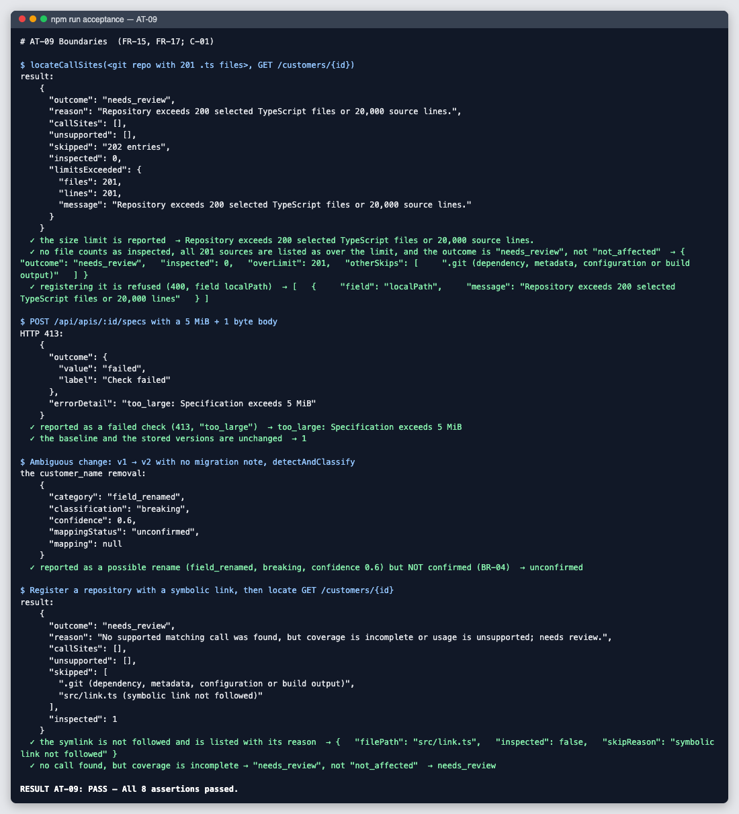

# AT-09 — Boundaries

**Result: PASS.** All 8 assertions passed.

<!-- Generated by `npm run acceptance` (scripts/acceptance/run.ts). Do not edit by hand. -->

| Field | Value |
| --- | --- |
| Requirements | FR-15, FR-17; C-01 |
| SRS procedure (Appendix A) | Test an oversized repository, an oversized specification, a symbolic link, and an ambiguous change. Verify limits are reported and compatibility is never inferred from uninspected code. |
| Build | commit `06d0e7939ead` on branch `feat/inc17a-early-deliverables` (clean working tree apart from docs/acceptance) |
| Run at | 2026-11-22T06:00:19.224Z (took 0.5 s) |
| Environment | macOS 26.6, Darwin 25.6.0 (arm64); Node v22.19.0; Docker 29.9.2; PostgreSQL 16.15 (Debian 16.15-1.pgdg13+2); oasdiff 1.35.0 |
| Database | `sma_acceptance_test`, dropped, re-created and migrated at the start of the run |
| Re-run | `npm run acceptance` |

## Inputs

- A git repository with 201 TypeScript files (limit: 200 files / 20,000 lines).
- A spec upload of 5 MiB + 1 byte (limit: 5 MiB).
- A git repository with `src/a.ts` and a symlink `src/link.ts → a.ts`.
- v1 → v2 with no migration note (the `customer_name` → `full_name` rename is ambiguous without one).

## Steps actually run

1. locateCallSites(<git repo with 201 .ts files>, GET /customers/{id})
2. POST /api/apis/:id/specs with a 5 MiB + 1 byte body
3. Ambiguous change: v1 → v2 with no migration note, detectAndClassify
4. Register a repository with a symbolic link, then locate GET /customers/{id}

## Actual output

Full transcript: [output/AT-09.txt](output/AT-09.txt).

Terminal screenshot (the transcript rendered as a terminal window; dashboard screenshots come with inc 14):



```text
# AT-09 Boundaries  (FR-15, FR-17; C-01)

$ locateCallSites(<git repo with 201 .ts files>, GET /customers/{id})
result:
    {
      "outcome": "needs_review",
      "reason": "Repository exceeds 200 selected TypeScript files or 20,000 source lines.",
      "callSites": [],
      "unsupported": [],
      "skipped": "202 entries",
      "inspected": 0,
      "limitsExceeded": {
        "files": 201,
        "lines": 201,
        "message": "Repository exceeds 200 selected TypeScript files or 20,000 source lines."
      }
    }
  ✓ the size limit is reported  → Repository exceeds 200 selected TypeScript files or 20,000 source lines.
  ✓ no file counts as inspected, all 201 sources are listed as over the limit, and the outcome is "needs_review", not "not_affected"  → {   "outcome": "needs_review",   "inspected": 0,   "overLimit": 201,   "otherSkips": [     ".git (dependency, metadata, configuration or build output)"   ] }
  ✓ registering it is refused (400, field localPath)  → [   {     "field": "localPath",     "message": "Repository exceeds 200 selected TypeScript files or 20,000 lines"   } ]

$ POST /api/apis/:id/specs with a 5 MiB + 1 byte body
HTTP 413:
    {
      "outcome": {
        "value": "failed",
        "label": "Check failed"
      },
      "errorDetail": "too_large: Specification exceeds 5 MiB"
    }
  ✓ reported as a failed check (413, "too_large")  → too_large: Specification exceeds 5 MiB
  ✓ the baseline and the stored versions are unchanged  → 1

$ Ambiguous change: v1 → v2 with no migration note, detectAndClassify
the customer_name removal:
    {
      "category": "field_renamed",
      "classification": "breaking",
      "confidence": 0.6,
      "mappingStatus": "unconfirmed",
      "mapping": null
    }
  ✓ reported as a possible rename (field_renamed, breaking, confidence 0.6) but NOT confirmed (BR-04)  → unconfirmed

$ Register a repository with a symbolic link, then locate GET /customers/{id}
result:
    {
      "outcome": "needs_review",
      "reason": "No supported matching call was found, but coverage is incomplete or usage is unsupported; needs review.",
      "callSites": [],
      "unsupported": [],
      "skipped": [
        ".git (dependency, metadata, configuration or build output)",
        "src/link.ts (symbolic link not followed)"
      ],
      "inspected": 1
    }
  ✓ the symlink is not followed and is listed with its reason  → {   "filePath": "src/link.ts",   "inspected": false,   "skipReason": "symbolic link not followed" }
  ✓ no call found, but coverage is incomplete → "needs_review", not "not_affected"  → needs_review

RESULT AT-09: PASS — All 8 assertions passed.
```

## Not run on this build

Nothing. Every part of the procedure ran.

## Result

**PASS.** All 8 assertions passed.
