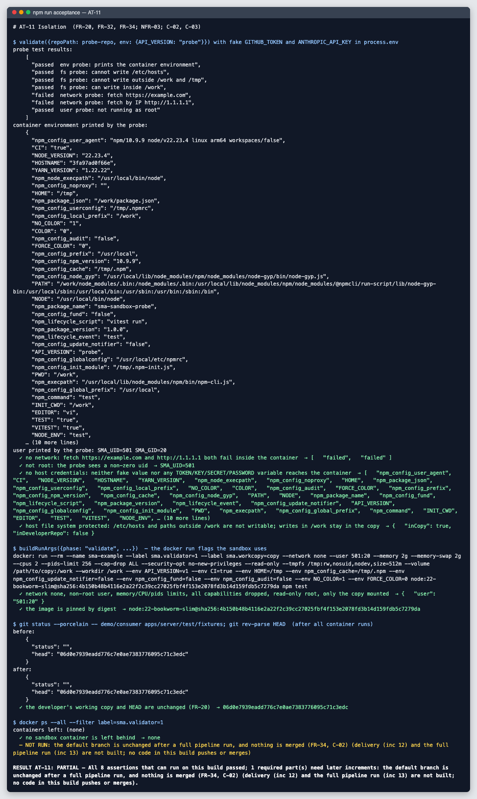

# AT-11 — Isolation

**Result: PARTIAL.** All 8 assertions that can run on this build passed; 1 required part(s) need later increments: the default branch is unchanged after a full pipeline run, and nothing is merged (FR-34, C-02) (delivery (inc 12) and the full pipeline run (inc 13) are not built; no code in this build pushes or merges).

<!-- Generated by `npm run acceptance` (scripts/acceptance/run.ts). Do not edit by hand. -->

| Field | Value |
| --- | --- |
| Requirements | FR-20, FR-32, FR-34; NFR-03; C-02, C-03 |
| SRS procedure (Appendix A) | Verify the container runs without network access, without host credentials, and as a non-root user, and that the developer’s working copy and the default branch are unchanged after a full run. |
| Build | commit `06d0e7939ead` on branch `feat/inc17a-early-deliverables` (clean working tree apart from docs/acceptance) |
| Run at | 2026-11-22T06:00:19.224Z (took 2.8 s) |
| Environment | macOS 26.6, Darwin 25.6.0 (arm64); Node v22.19.0; Docker 29.9.2; PostgreSQL 16.15 (Debian 16.15-1.pgdg13+2); oasdiff 1.35.0 |
| Database | `sma_acceptance_test`, dropped, re-created and migrated at the start of the run |
| Re-run | `npm run acceptance` |

## Inputs

- The probe repository `apps/server/test/fixtures/validator/probe-repo`: 7 Vitest tests that try the network, print the user id and environment, and write to the file system.
- Fake host credentials set in the server process: `GITHUB_TOKEN=ghp_FAKE…`, `ANTHROPIC_API_KEY=sk-ant-FAKE…`.
- This repository (`demo/consumer`, test fixtures) before and after every container run of AT-07 and AT-11.

## Steps actually run

1. validate({repoPath: probe-repo, env: {API_VERSION: "probe"}}) with fake GITHUB_TOKEN and ANTHROPIC_API_KEY in process.env
2. buildRunArgs({phase: "validate", ...})  — the docker run flags the sandbox uses
3. git status --porcelain -- demo/consumer apps/server/test/fixtures; git rev-parse HEAD  (after all container runs)
4. docker ps --all --filter label=sma.validator=1

## Actual output

Full transcript: [output/AT-11.txt](output/AT-11.txt).

Terminal screenshot (the transcript rendered as a terminal window; dashboard screenshots come with inc 14):



```text
# AT-11 Isolation  (FR-20, FR-32, FR-34; NFR-03; C-02, C-03)

$ validate({repoPath: probe-repo, env: {API_VERSION: "probe"}}) with fake GITHUB_TOKEN and ANTHROPIC_API_KEY in process.env
probe test results:
    [
      "passed  env probe: prints the container environment",
      "passed  fs probe: cannot write /etc/hosts",
      "passed  fs probe: cannot write outside /work and /tmp",
      "passed  fs probe: can write inside /work",
      "failed  network probe: fetch https://example.com",
      "failed  network probe: fetch by IP http://1.1.1.1",
      "passed  user probe: not running as root"
    ]
container environment printed by the probe:
    {
      "npm_config_user_agent": "npm/10.9.9 node/v22.23.4 linux arm64 workspaces/false",
      "CI": "true",
      "NODE_VERSION": "22.23.4",
      "HOSTNAME": "3fa97ad0f66e",
      "YARN_VERSION": "1.22.22",
      "npm_node_execpath": "/usr/local/bin/node",
      "npm_config_noproxy": "",
      "HOME": "/tmp",
      "npm_package_json": "/work/package.json",
      "npm_config_userconfig": "/tmp/.npmrc",
      "npm_config_local_prefix": "/work",
      "NO_COLOR": "1",
      "COLOR": "0",
      "npm_config_audit": "false",
      "FORCE_COLOR": "0",
      "npm_config_prefix": "/usr/local",
      "npm_config_npm_version": "10.9.9",
      "npm_config_cache": "/tmp/.npm",
      "npm_config_node_gyp": "/usr/local/lib/node_modules/npm/node_modules/node-gyp/bin/node-gyp.js",
      "PATH": "/work/node_modules/.bin:/node_modules/.bin:/usr/local/lib/node_modules/npm/node_modules/@npmcli/run-script/lib/node-gyp-bin:/usr/local/sbin:/usr/local/bin:/usr/sbin:/usr/bin:/sbin:/bin",
      "NODE": "/usr/local/bin/node",
      "npm_package_name": "sma-sandbox-probe",
      "npm_config_fund": "false",
      "npm_lifecycle_script": "vitest run",
      "npm_package_version": "1.0.0",
      "npm_lifecycle_event": "test",
      "npm_config_update_notifier": "false",
      "API_VERSION": "probe",
      "npm_config_globalconfig": "/usr/local/etc/npmrc",
      "npm_config_init_module": "/tmp/.npm-init.js",
      "PWD": "/work",
      "npm_execpath": "/usr/local/lib/node_modules/npm/bin/npm-cli.js",
      "npm_config_global_prefix": "/usr/local",
      "npm_command": "test",
      "INIT_CWD": "/work",
      "EDITOR": "vi",
      "TEST": "true",
      "VITEST": "true",
      "NODE_ENV": "test",
    … (10 more lines)
user printed by the probe: SMA_UID=501 SMA_GID=20
  ✓ no network: fetch https://example.com and http://1.1.1.1 both fail inside the container  → [   "failed",   "failed" ]
  ✓ not root: the probe sees a non-zero uid  → SMA_UID=501
  ✓ no host credentials: neither fake value nor any TOKEN/KEY/SECRET/PASSWORD variable reaches the container  → [   "npm_config_user_agent",   "CI",   "NODE_VERSION",   "HOSTNAME",   "YARN_VERSION",   "npm_node_execpath",   "npm_config_noproxy",   "HOME",   "npm_package_json",   "npm_config_userconfig",   "npm_config_local_prefix",   "NO_COLOR",   "COLOR",   "npm_config_audit",   "FORCE_COLOR",   "npm_config_prefix",   "npm_config_npm_version",   "npm_config_cache",   "npm_config_node_gyp",   "PATH",   "NODE",   "npm_package_name",   "npm_config_fund",   "npm_lifecycle_script",   "npm_package_version",   "npm_lifecycle_event",   "npm_config_update_notifier",   "API_VERSION",   "npm_config_globalconfig",   "npm_config_init_module",   "PWD",   "npm_execpath",   "npm_config_global_prefix",   "npm_command",   "INIT_CWD",   "EDITOR",   "TEST",   "VITEST",   "NODE_ENV", … (10 more lines)
  ✓ host file system protected: /etc/hosts and paths outside /work are not writable; writes in /work stay in the copy  → {   "inCopy": true,   "inDeveloperRepo": false }

$ buildRunArgs({phase: "validate", ...})  — the docker run flags the sandbox uses
docker: run --rm --name sma-example --label sma.validator=1 --label sma.workcopy=copy --network none --user 501:20 --memory 2g --memory-swap 2g --cpus 2 --pids-limit 256 --cap-drop ALL --security-opt no-new-privileges --read-only --tmpfs /tmp:rw,nosuid,nodev,size=512m --volume /path/to/copy:/work --workdir /work --env API_VERSION=v1 --env CI=true --env HOME=/tmp --env npm_config_cache=/tmp/.npm --env npm_config_update_notifier=false --env npm_config_fund=false --env npm_config_audit=false --env NO_COLOR=1 --env FORCE_COLOR=0 node:22-bookworm-slim@sha256:4b150b48b4116e2a22f2c39cc27025fbf4f153e2078fd3b14d159fdb5c7279da npm test
  ✓ network none, non-root user, memory/CPU/pids limits, all capabilities dropped, read-only root, only the copy mounted  → {   "user": "501:20" }
  ✓ the image is pinned by digest  → node:22-bookworm-slim@sha256:4b150b48b4116e2a22f2c39cc27025fbf4f153e2078fd3b14d159fdb5c7279da

$ git status --porcelain -- demo/consumer apps/server/test/fixtures; git rev-parse HEAD  (after all container runs)
before:
    {
      "status": "",
      "head": "06d0e7939eadd776c7e0ae7383776095c71c3edc"
    }
after:
    {
      "status": "",
      "head": "06d0e7939eadd776c7e0ae7383776095c71c3edc"
    }
  ✓ the developer's working copy and HEAD are unchanged (FR-20)  → 06d0e7939eadd776c7e0ae7383776095c71c3edc

$ docker ps --all --filter label=sma.validator=1
containers left: (none)
  ✓ no sandbox container is left behind  → none
  – NOT RUN: the default branch is unchanged after a full pipeline run, and nothing is merged (FR-34, C-02) (delivery (inc 12) and the full pipeline run (inc 13) are not built; no code in this build pushes or merges)

RESULT AT-11: PARTIAL — All 8 assertions that can run on this build passed; 1 required part(s) need later increments: the default branch is unchanged after a full pipeline run, and nothing is merged (FR-34, C-02) (delivery (inc 12) and the full pipeline run (inc 13) are not built; no code in this build pushes or merges).
```

## Not run on this build

- the default branch is unchanged after a full pipeline run, and nothing is merged (FR-34, C-02): delivery (inc 12) and the full pipeline run (inc 13) are not built; no code in this build pushes or merges.

## Result

**PARTIAL.** All 8 assertions that can run on this build passed; 1 required part(s) need later increments: the default branch is unchanged after a full pipeline run, and nothing is merged (FR-34, C-02) (delivery (inc 12) and the full pipeline run (inc 13) are not built; no code in this build pushes or merges).
