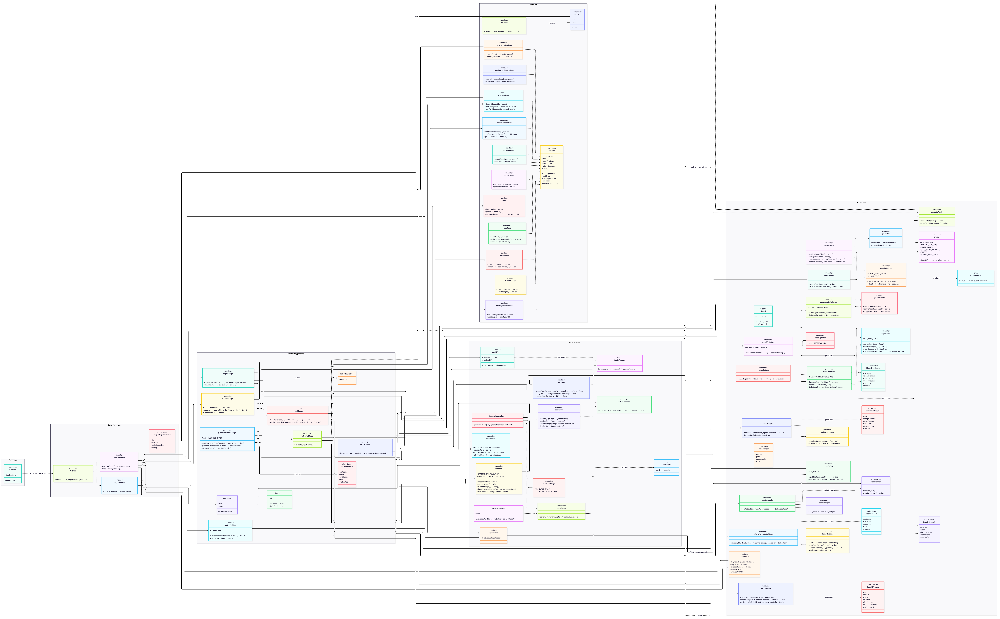

# UML class diagram — Self-Maintaining APIs

Built from the code on `main` after Increment 10. Every node below is a real TypeScript module,
class, interface, or type in the repository. The table under the diagram lists each one with its
file, and `npm run diagrams:check` checks that every listed symbol is in that file.

**Notation**

- TypeScript has modules, not only classes. A module (a file of exported functions and constants)
  is drawn as a class with the `<<module>>` stereotype. Its "methods" are its exported functions.
- `<<interface>>` marks a TypeScript `interface`. `<<type>>` marks an exported `type` alias, such
  as a function type or a union.
- A real `class` has no stereotype: `AnthropicLlmAdapter`, `FakeLlmAdapter`, `CheckQueue`,
  `SpecPoller`, `ApiNotFoundError`.
- `..>` means "depends on / imports". `..|>` means "implements". `-->` means "holds a reference".
- The layers follow the MVC mapping in `docs/architecture.md`:
  **Model** = `packages/core` plus `apps/server/src/infra/db`. **Controller** =
  `apps/server/src/http` plus `apps/server/src/pipeline`. **View** = `apps/web`. The
  **Infrastructure adapters** (`apps/server/src/infra/*` except `db`) are the only code that
  touches processes, Docker, the file system, the network, or the LLM provider. The Controller
  calls them.
- **Not built yet:** the repair loop (inc 11), delivery (inc 12), the pipeline orchestrator
  (inc 13), and the dashboard views (inc 14). None of them appear as nodes, so the diagram shows
  only code that exists.

```mermaid
classDiagram
  direction LR

  namespace Model_core {
    class enums {
      <<module>>
      +RUN_STATUSES
      +ATTEMPT_OUTCOMES
      +GUARD_NAMES
      +SPEC_CHECK_OUTCOMES
      +STAGES
      +CHANGE_CATEGORIES
      +labelOf(enumName, value) string
    }
    class Result {
      <<type>>
      Ok~T~ | Err~E~
      +ok(value) Ok
      +err(error) Err
    }
    class apiContract {
      <<module>>
      +RegisterRepositorySchema
      +RegisterApiSchema
      +IngestResponseSchema
      +ChangeSchema
      +API_CONTRACT
    }
    class ingestSpec {
      <<module>>
      +MAX_SPEC_BYTES
      +parseSpec(text) Result
      +normalizeSpec(doc) string
      +hashSpec(canonical) string
      +decideCheckOutcome(input) SpecCheckOutcome
    }
    class repoLimits {
      <<module>>
      +REPO_LIMITS
      +repoSkipReason(path, kind) string
      +countRepoSize(repoPath, reader) RepoSize
    }
    class RepoReader {
      <<interface>>
      +entries(path)
      +read(root, path) string
    }
    class SpecDifference {
      <<interface>>
      +id
      +ruleId
      +path
      +method
      +jsonPointer
      +evidenceBefore
      +evidenceAfter
    }
    class detectPointer {
      <<module>>
      +buildJsonPointer(segments) string
      +parseJsonPointer(pointer) string[]
      +extractEvidence(doc, pointer) unknown
      +resolveAnchor(doc, anchor)
    }
    class detectParse {
      <<module>>
      +parseOasdiffChangelog(raw, specs) Result
      +anchorFor(ruleId, method, details) DifferenceAnchor
      +differenceId(ruleId, method, path, jsonPointer) string
    }
    class migrationNoteParse {
      <<module>>
      +MigrationMappingSchema
      +parseMigrationNote(text) Result
      +findMapping(note, difference, category)
    }
    class migrationNoteValidate {
      <<module>>
      +mappingMatchesEvidence(mapping, change, before, after) boolean
    }
    class classifyRules {
      <<module>>
      +CLASSIFICATION_RULES
    }
    class classifyModule {
      <<module>>
      +NO_REPLACEMENT_REASON
      +classify(differences, note) ClassifiedChange[]
    }
    class ClassifiedChange {
      <<interface>>
      +category
      +classification
      +confidence
      +mappingStatus
      +mapping
      +reason
    }
    class LocateTarget {
      <<interface>>
      +method
      +path
      +operationId
      +field
    }
    class LocateResult {
      <<interface>>
      +outcome
      +callSites
      +coverage
      +unsupported
      +reason
    }
    class locateModule {
      <<module>>
      +locateCallSites(repoPath, target, reader) LocateResult
    }
    class locateAnalyze {
      <<module>>
      +analyzeSources(sources, target)
    }
    class ValidationResult {
      <<interface>>
      +status
      +compileErrors
      +testsPassed
      +testsTotal
      +testResults
      +rawOutput
    }
    class validateParsers {
      <<module>>
      +parseTscOutput(output) TscOutput
      +parseVitestJson(json, rootDir) Result
    }
    class validateResult {
      <<module>>
      +buildValidationResult(inputs) ValidationResult
      +formatRawOutput(runs) string
    }
    class validatePatch {
      <<module>>
      +inspectPatch(diff) Result
      +unsafePathReason(path) string
    }
    class guardsDiff {
      <<module>>
      +parseUnifiedDiff(diff) Result
      +changedLines(file) Set
    }
    class guardsPaths {
      <<module>>
      +testPathReason(path) string
      +configPathReason(path) string
      +isTypeScriptPath(path) boolean
    }
    class guardsStatic {
      <<module>>
      +testFileGuard(files) string[]
      +configGuard(files) string[]
      +typeSuppressionGuard(files, post) string[]
      +runStaticGuards(patch, post) GuardVerdict
    }
    class guardsCount {
      <<module>>
      +countGuard(pre, post) string[]
      +runCountGuard(pre, post) GuardVerdict
    }
    class guardsVerdict {
      <<module>>
      +STATIC_GUARD_ORDER
      +GUARD_ORDER
      +verdictFromHits(hits) GuardVerdict
      +cheatingEndsRun(outcome) boolean
    }
    class GuardVerdict {
      <<type>>
      ok true | ok false, guard, evidence
    }
    class repairContext {
      <<module>>
      +MAX_PREVIOUS_ERROR_CHARS
      +isRepairSourcePath(path) boolean
      +redactRepairSecrets(text)
      +buildRepairContext(input) RepairContext
    }
    class RepairContext {
      <<interface>>
      +system
      +user
      +includedFiles
      +redactions
      +approxTokens
    }
    class repairOutput {
      <<module>>
      +parseRepairOutput(text, includedFiles) RepairOutput
    }
  }

  namespace Model_db {
    class schema {
      <<module>>
      +repositories
      +apis
      +specVersions
      +specChecks
      +migrationNotes
      +changes
      +runs
      +runStageResults
      +callSites
      +coverageEntries
      +attempts
      +evaluationResults
    }
    class DbClient {
      <<interface>>
      +db
      +pool
      +close()
    }
    class dbClient {
      <<module>>
      +createDbClient(connectionString) DbClient
    }
    class specVersionsRepo {
      <<module>>
      +insertSpecVersion(db, values)
      +findSpecVersionByHash(db, apiId, hash)
      +getSpecVersionById(db, id)
    }
    class apisRepo {
      <<module>>
      +insertApi(db, values)
      +getApiById(db, id)
      +setBaselineVersion(db, apiId, versionId)
    }
    class repositoriesRepo {
      <<module>>
      +insertRepository(db, values)
      +getRepositoryById(db, id)
    }
    class specChecksRepo {
      <<module>>
      +insertSpecCheck(db, values)
      +listSpecChecks(db, apiId)
    }
    class migrationNotesRepo {
      <<module>>
      +insertMigrationNote(db, values)
      +findMigrationNote(db, from, to)
    }
    class changesRepo {
      <<module>>
      +insertChange(db, values)
      +listChangesForVersions(db, from, to)
      +confirmMapping(db, id, confirmation)
    }
    class runsRepo {
      <<module>>
      +insertRun(db, values)
      +updateRunProgress(db, id, progress)
      +finishRun(db, id, finish)
    }
    class runStageResultsRepo {
      <<module>>
      +insertStageResult(db, values)
      +listStageResults(db, runId)
    }
    class locateRepo {
      <<module>>
      +insertCallSites(db, values)
      +insertCoverageEntries(db, values)
    }
    class attemptsRepo {
      <<module>>
      +insertAttempt(db, values)
      +listAttempts(db, runId)
    }
    class evaluationResultsRepo {
      <<module>>
      +insertEvaluationResult(db, values)
      +listEvaluationResults(db, evalLabel)
    }
  }

  namespace Controller_http {
    class httpApp {
      <<module>>
      +buildApp(opts, deps) FastifyInstance
    }
    class ingestRoutes {
      <<module>>
      +registerIngestRoutes(app, deps)
    }
    class IngestDependencies {
      <<interface>>
      +db
      +retrieve
      +probeRepository
      +polling
    }
    class classifyRoutes {
      <<module>>
      +registerClassifyRoutes(app, deps)
      +labeledChange(change)
    }
  }

  namespace Controller_pipeline {
    class ingestStage {
      <<module>>
      +ingest(db, apiId, source, retrieve) IngestResponse
      +advanceBaseline(db, apiId, versionId)
    }
    class ApiNotFoundError {
      +message
    }
    class configValidate {
      <<module>>
      +probeGitHub
      +validateRepository(input, probe) Result
      +validateApi(input) Result
    }
    class CheckQueue {
      -tail
      +run(task) Promise
      +drain() Promise
    }
    class SpecPoller {
      -due
      -busy
      +tick() Promise
    }
    class detectStage {
      <<module>>
      +detectChanges(db, apiId, from, to, deps) Result
      +persistClassifiedChanges(db, apiId, from, to, items) Change[]
    }
    class classifyStage {
      <<module>>
      +loadVersionPair(db, apiId, from, to)
      +detectAndClassify(db, apiId, from, to, deps) Result
      +changeSpecs(db, change)
    }
    class locateStage {
      <<module>>
      +locate(db, runId, repoPath, target, deps) LocateResult
    }
    class validateStage {
      <<module>>
      +validate(input) Result
    }
    class guardedValidateStage {
      <<module>>
      +MAX_GUARD_FILE_BYTES
      +readPostPatchFiles(repoPath, commit, patch, files)
      +guardedValidate(input, deps) GuardedVerdict
      +attemptFieldsFromVerdict(verdict)
    }
    class GuardedVerdict {
      <<interface>>
      +outcome
      +guard
      +evidence
      +result
      +validated
    }
  }

  namespace Infra_adapters {
    class OasdiffRunner {
      <<type>>
      fn(base, revision, options) Promise~Result~
    }
    class oasdiffRunner {
      <<module>>
      +OASDIFF_VERSION
      +checkOasdiffVersion(options)
      +runOasdiff
    }
    class repoReader {
      <<module>>
      +fileSystemRepoReader
    }
    class specSource {
      <<module>>
      +retrieveSpec(url, options) Result
      +redact(text) string
      +containsCredential(value) boolean
      +allowedSpecUrl(value) boolean
    }
    class processRunner {
      <<module>>
      +runProcess(command, args, options) ProcessOutcome
    }
    class dockerCli {
      <<module>>
      +docker(args, options, timeoutMs)
      +dockerServerVersion(options)
      +ensureImage(image, options, timeoutMs)
      +killContainer(name, options)
    }
    class validatorImage {
      <<module>>
      +VALIDATOR_IMAGE
      +VALIDATOR_IMAGE_DIGEST
    }
    class sandbox {
      <<module>>
      +SANDBOX_ENV_ALLOWLIST
      +DEFAULT_VALIDATE_TIMEOUT_MS
      +checkSandboxEnv(env)
      +sandboxUser() string
      +buildRunArgs(p) string[]
      +installDependencies(workDir, options) Result
      +runChecks(workDir, options) Result
    }
    class workcopy {
      <<module>>
      +createWorkingCopy(repoPath, commitSha, options) Result
      +applyPatch(workDir, unifiedDiff, options) Result
      +disposeWorkingCopy(workDir, options)
    }
    class LlmAdapter {
      <<interface>>
      +generatePatch(ctx, opts) Promise~LlmResult~
    }
    class LlmResult {
      <<type>>
      patch | refusal | error
    }
    class AnthropicLlmAdapter {
      +generatePatch(ctx, opts) Promise~LlmResult~
    }
    class FakeLlmAdapter {
      +calls
      +generatePatch(ctx, opts) Promise~LlmResult~
    }
  }

  namespace View_web {
    class WebApp {
      <<module>>
      +App() JSX
      +HealthState
    }
  }

  %% ---- Model (core) internal dependencies ----
  detectParse ..> detectPointer
  detectParse ..> SpecDifference : produces
  classifyModule ..> classifyRules
  classifyModule ..> migrationNoteParse
  classifyModule ..> ClassifiedChange : produces
  migrationNoteValidate ..> detectPointer
  locateModule ..> repoLimits
  locateModule ..> locateAnalyze
  locateModule ..> RepoReader : reads through
  locateModule ..> LocateResult : produces
  validateResult ..> validateParsers
  validateResult ..> ValidationResult : produces
  guardsDiff ..> validatePatch
  guardsStatic ..> guardsDiff
  guardsStatic ..> guardsPaths
  guardsStatic ..> guardsVerdict
  guardsCount ..> guardsVerdict
  guardsVerdict ..> GuardVerdict : produces
  guardsVerdict ..> enums
  repairContext ..> ClassifiedChange
  repairContext ..> guardsPaths
  repairContext ..> ingestSpec
  repairContext ..> RepairContext : produces
  repairOutput ..> repairContext
  schema ..> enums : pgEnums built from

  %% ---- Model (db) ----
  dbClient ..> DbClient : creates
  dbClient ..> schema
  specVersionsRepo ..> schema
  apisRepo ..> schema
  repositoriesRepo ..> schema
  specChecksRepo ..> schema
  migrationNotesRepo ..> schema
  changesRepo ..> schema
  runsRepo ..> schema
  runStageResultsRepo ..> schema
  locateRepo ..> schema
  attemptsRepo ..> schema
  evaluationResultsRepo ..> schema

  %% ---- Controller (http) ----
  httpApp ..> ingestRoutes
  httpApp ..> classifyRoutes
  ingestRoutes ..> IngestDependencies
  IngestDependencies --> DbClient : db
  ingestRoutes ..> ingestStage
  ingestRoutes ..> configValidate
  ingestRoutes ..> CheckQueue
  ingestRoutes ..> SpecPoller
  SpecPoller --> CheckQueue
  classifyRoutes ..> classifyStage
  classifyRoutes ..> migrationNoteParse
  classifyRoutes ..> migrationNoteValidate
  classifyRoutes ..> changesRepo
  classifyRoutes ..> migrationNotesRepo
  classifyRoutes ..> apiContract

  %% ---- Controller (pipeline) ----
  ingestStage ..> ingestSpec
  ingestStage ..> specSource
  ingestStage ..> specVersionsRepo
  ingestStage ..> apisRepo
  ingestStage ..> ApiNotFoundError : throws
  configValidate ..> apiContract
  configValidate ..> repoLimits
  configValidate ..> repoReader
  configValidate ..> specSource
  detectStage ..> oasdiffRunner
  detectStage ..> OasdiffRunner
  detectStage ..> detectParse
  detectStage ..> changesRepo
  classifyStage ..> detectStage
  classifyStage ..> classifyModule
  classifyStage ..> migrationNotesRepo
  locateStage ..> locateModule
  locateStage ..> repoReader
  locateStage ..> locateRepo
  locateStage ..> runStageResultsRepo
  validateStage ..> workcopy
  validateStage ..> sandbox
  validateStage ..> dockerCli
  validateStage ..> validatePatch
  guardedValidateStage ..> validateStage
  guardedValidateStage ..> workcopy
  guardedValidateStage ..> guardsStatic
  guardedValidateStage ..> guardsCount
  guardedValidateStage ..> GuardedVerdict : produces

  %% ---- Infrastructure adapters ----
  oasdiffRunner ..|> OasdiffRunner : runOasdiff
  repoReader ..|> RepoReader : fileSystemRepoReader
  sandbox ..> dockerCli
  sandbox ..> validatorImage
  sandbox ..> validateResult
  dockerCli ..> processRunner
  workcopy ..> processRunner
  workcopy ..> validatePatch
  AnthropicLlmAdapter ..|> LlmAdapter
  FakeLlmAdapter ..|> LlmAdapter
  LlmAdapter ..> RepairContext : consumes
  LlmAdapter ..> LlmResult : returns
  AnthropicLlmAdapter ..> repairOutput
  AnthropicLlmAdapter ..> repairContext

  %% ---- View ----
  WebApp ..> httpApp : HTTP GET /health
```

## Every node and the file it lives in

`npm run diagrams:check` reads this table. For each row it checks that the file exists and that
every symbol in backticks appears in it. It also checks that every node in the diagram has a row.

| Node                    | Kind      | Symbols checked                                                                                                                                                    | File                                                |
| ----------------------- | --------- | ------------------------------------------------------------------------------------------------------------------------------------------------------------------ | --------------------------------------------------- |
| `enums`                 | module    | `RUN_STATUSES` `ATTEMPT_OUTCOMES` `GUARD_NAMES` `SPEC_CHECK_OUTCOMES` `STAGES` `labelOf`                                                                           | `packages/core/src/domain/enums.ts`                 |
| `Result`                | type      | `Result` `ok` `err`                                                                                                                                                | `packages/core/src/result.ts`                       |
| `apiContract`           | module    | `RegisterRepositorySchema` `RegisterApiSchema` `IngestResponseSchema` `ChangeSchema` `API_CONTRACT`                                                                | `packages/core/src/api/contract.ts`                 |
| `ingestSpec`            | module    | `MAX_SPEC_BYTES` `parseSpec` `normalizeSpec` `hashSpec` `decideCheckOutcome`                                                                                       | `packages/core/src/ingest/spec.ts`                  |
| `repoLimits`            | module    | `REPO_LIMITS` `repoSkipReason` `countRepoSize`                                                                                                                     | `packages/core/src/repo/limits.ts`                  |
| `RepoReader`            | interface | `RepoReader` `entries` `read`                                                                                                                                      | `packages/core/src/repo/limits.ts`                  |
| `SpecDifference`        | interface | `SpecDifference` `jsonPointer` `evidenceBefore` `evidenceAfter`                                                                                                    | `packages/core/src/detect/types.ts`                 |
| `detectPointer`         | module    | `buildJsonPointer` `parseJsonPointer` `extractEvidence` `resolveAnchor`                                                                                            | `packages/core/src/detect/pointer.ts`               |
| `detectParse`           | module    | `parseOasdiffChangelog` `anchorFor` `differenceId`                                                                                                                 | `packages/core/src/detect/parse.ts`                 |
| `migrationNoteParse`    | module    | `MigrationMappingSchema` `parseMigrationNote` `findMapping`                                                                                                        | `packages/core/src/migration-note/parse.ts`         |
| `migrationNoteValidate` | module    | `mappingMatchesEvidence`                                                                                                                                           | `packages/core/src/migration-note/validate.ts`      |
| `classifyRules`         | module    | `CLASSIFICATION_RULES`                                                                                                                                             | `packages/core/src/classify/rules.ts`               |
| `classifyModule`        | module    | `NO_REPLACEMENT_REASON` `classify`                                                                                                                                 | `packages/core/src/classify/classify.ts`            |
| `ClassifiedChange`      | interface | `ClassifiedChange` `mappingStatus` `reason`                                                                                                                        | `packages/core/src/classify/classify.ts`            |
| `LocateTarget`          | interface | `LocateTarget` `operationId`                                                                                                                                       | `packages/core/src/locate/types.ts`                 |
| `LocateResult`          | interface | `LocateResult` `callSites` `coverage` `unsupported`                                                                                                                | `packages/core/src/locate/types.ts`                 |
| `locateModule`          | module    | `locateCallSites`                                                                                                                                                  | `packages/core/src/locate/locate.ts`                |
| `locateAnalyze`         | module    | `analyzeSources`                                                                                                                                                   | `packages/core/src/locate/analyze.ts`               |
| `ValidationResult`      | interface | `ValidationResult` `compileErrors` `testsPassed` `testsTotal` `rawOutput`                                                                                          | `packages/core/src/validate/types.ts`               |
| `validateParsers`       | module    | `parseTscOutput`                                                                                                                                                   | `packages/core/src/validate/tsc.ts`                 |
| `validateParsers`       | module    | `parseVitestJson`                                                                                                                                                  | `packages/core/src/validate/vitest.ts`              |
| `validateResult`        | module    | `buildValidationResult` `formatRawOutput`                                                                                                                          | `packages/core/src/validate/result.ts`              |
| `validatePatch`         | module    | `inspectPatch` `unsafePathReason`                                                                                                                                  | `packages/core/src/validate/patch.ts`               |
| `guardsDiff`            | module    | `parseUnifiedDiff` `changedLines`                                                                                                                                  | `packages/core/src/guards/diff.ts`                  |
| `guardsPaths`           | module    | `testPathReason` `configPathReason` `isTypeScriptPath`                                                                                                             | `packages/core/src/guards/paths.ts`                 |
| `guardsStatic`          | module    | `testFileGuard` `configGuard` `typeSuppressionGuard` `runStaticGuards`                                                                                             | `packages/core/src/guards/static.ts`                |
| `guardsCount`           | module    | `countGuard` `runCountGuard`                                                                                                                                       | `packages/core/src/guards/count.ts`                 |
| `guardsVerdict`         | module    | `STATIC_GUARD_ORDER` `GUARD_ORDER` `verdictFromHits` `cheatingEndsRun`                                                                                             | `packages/core/src/guards/verdict.ts`               |
| `GuardVerdict`          | type      | `GuardVerdict`                                                                                                                                                     | `packages/core/src/guards/verdict.ts`               |
| `repairContext`         | module    | `MAX_PREVIOUS_ERROR_CHARS` `isRepairSourcePath` `redactRepairSecrets` `buildRepairContext`                                                                         | `packages/core/src/repair/context.ts`               |
| `RepairContext`         | interface | `RepairContext` `includedFiles` `redactions` `approxTokens`                                                                                                        | `packages/core/src/repair/context.ts`               |
| `repairOutput`          | module    | `parseRepairOutput`                                                                                                                                                | `packages/core/src/repair/output.ts`                |
| `schema`                | module    | `repositories` `apis` `specVersions` `specChecks` `migrationNotes` `changes` `runs` `runStageResults` `callSites` `coverageEntries` `attempts` `evaluationResults` | `apps/server/src/infra/db/schema.ts`                |
| `DbClient`              | interface | `DbClient` `pool` `close`                                                                                                                                          | `apps/server/src/infra/db/client.ts`                |
| `dbClient`              | module    | `createDbClient`                                                                                                                                                   | `apps/server/src/infra/db/client.ts`                |
| `specVersionsRepo`      | module    | `insertSpecVersion` `findSpecVersionByHash` `getSpecVersionById`                                                                                                   | `apps/server/src/infra/db/specVersionsRepo.ts`      |
| `apisRepo`              | module    | `insertApi` `getApiById` `setBaselineVersion`                                                                                                                      | `apps/server/src/infra/db/apisRepo.ts`              |
| `repositoriesRepo`      | module    | `insertRepository` `getRepositoryById`                                                                                                                             | `apps/server/src/infra/db/repositoriesRepo.ts`      |
| `specChecksRepo`        | module    | `insertSpecCheck` `listSpecChecks`                                                                                                                                 | `apps/server/src/infra/db/specChecksRepo.ts`        |
| `migrationNotesRepo`    | module    | `insertMigrationNote` `findMigrationNote`                                                                                                                          | `apps/server/src/infra/db/migrationNotesRepo.ts`    |
| `changesRepo`           | module    | `insertChange` `listChangesForVersions` `confirmMapping`                                                                                                           | `apps/server/src/infra/db/changesRepo.ts`           |
| `runsRepo`              | module    | `insertRun` `updateRunProgress` `finishRun`                                                                                                                        | `apps/server/src/infra/db/runsRepo.ts`              |
| `runStageResultsRepo`   | module    | `insertStageResult` `listStageResults`                                                                                                                             | `apps/server/src/infra/db/runStageResultsRepo.ts`   |
| `locateRepo`            | module    | `insertCallSites` `insertCoverageEntries`                                                                                                                          | `apps/server/src/infra/db/locateRepo.ts`            |
| `attemptsRepo`          | module    | `insertAttempt` `listAttempts`                                                                                                                                     | `apps/server/src/infra/db/attemptsRepo.ts`          |
| `evaluationResultsRepo` | module    | `insertEvaluationResult` `listEvaluationResults`                                                                                                                   | `apps/server/src/infra/db/evaluationResultsRepo.ts` |
| `httpApp`               | module    | `buildApp`                                                                                                                                                         | `apps/server/src/app.ts`                            |
| `ingestRoutes`          | module    | `registerIngestRoutes`                                                                                                                                             | `apps/server/src/http/ingest-routes.ts`             |
| `IngestDependencies`    | interface | `IngestDependencies` `retrieve` `probeRepository` `polling`                                                                                                        | `apps/server/src/http/ingest-routes.ts`             |
| `classifyRoutes`        | module    | `registerClassifyRoutes` `labeledChange`                                                                                                                           | `apps/server/src/http/classify-routes.ts`           |
| `ingestStage`           | module    | `ingest` `advanceBaseline`                                                                                                                                         | `apps/server/src/pipeline/ingest.ts`                |
| `ApiNotFoundError`      | class     | `class ApiNotFoundError`                                                                                                                                           | `apps/server/src/pipeline/ingest.ts`                |
| `configValidate`        | module    | `probeGitHub` `validateRepository` `validateApi`                                                                                                                   | `apps/server/src/pipeline/config-validate.ts`       |
| `CheckQueue`            | class     | `class CheckQueue` `drain`                                                                                                                                         | `apps/server/src/pipeline/poller.ts`                |
| `SpecPoller`            | class     | `class SpecPoller` `tick`                                                                                                                                          | `apps/server/src/pipeline/poller.ts`                |
| `detectStage`           | module    | `detectChanges` `persistClassifiedChanges`                                                                                                                         | `apps/server/src/pipeline/detect.ts`                |
| `classifyStage`         | module    | `loadVersionPair` `detectAndClassify` `changeSpecs`                                                                                                                | `apps/server/src/pipeline/classify.ts`              |
| `locateStage`           | module    | `locate`                                                                                                                                                           | `apps/server/src/pipeline/locate.ts`                |
| `validateStage`         | module    | `validate`                                                                                                                                                         | `apps/server/src/pipeline/validate.ts`              |
| `guardedValidateStage`  | module    | `MAX_GUARD_FILE_BYTES` `readPostPatchFiles` `guardedValidate` `attemptFieldsFromVerdict`                                                                           | `apps/server/src/pipeline/guarded-validate.ts`      |
| `GuardedVerdict`        | interface | `GuardedVerdict` `validated`                                                                                                                                       | `apps/server/src/pipeline/guarded-validate.ts`      |
| `OasdiffRunner`         | type      | `OasdiffRunner`                                                                                                                                                    | `apps/server/src/infra/oasdiff/runner.ts`           |
| `oasdiffRunner`         | module    | `checkOasdiffVersion` `runOasdiff`                                                                                                                                 | `apps/server/src/infra/oasdiff/runner.ts`           |
| `oasdiffRunner`         | module    | `OASDIFF_VERSION`                                                                                                                                                  | `apps/server/src/infra/oasdiff/version.ts`          |
| `repoReader`            | module    | `fileSystemRepoReader`                                                                                                                                             | `apps/server/src/infra/repo/reader.ts`              |
| `specSource`            | module    | `retrieveSpec`                                                                                                                                                     | `apps/server/src/infra/spec-source/retrieve.ts`     |
| `specSource`            | module    | `redact` `containsCredential` `allowedSpecUrl`                                                                                                                     | `apps/server/src/infra/spec-source/security.ts`     |
| `processRunner`         | module    | `runProcess`                                                                                                                                                       | `apps/server/src/infra/process.ts`                  |
| `dockerCli`             | module    | `docker` `dockerServerVersion` `ensureImage` `killContainer`                                                                                                       | `apps/server/src/infra/validator/docker.ts`         |
| `validatorImage`        | module    | `VALIDATOR_IMAGE` `VALIDATOR_IMAGE_DIGEST`                                                                                                                         | `apps/server/src/infra/validator/image.ts`          |
| `sandbox`               | module    | `SANDBOX_ENV_ALLOWLIST` `DEFAULT_VALIDATE_TIMEOUT_MS` `checkSandboxEnv` `sandboxUser` `buildRunArgs` `installDependencies` `runChecks`                             | `apps/server/src/infra/validator/sandbox.ts`        |
| `workcopy`              | module    | `createWorkingCopy` `applyPatch` `disposeWorkingCopy`                                                                                                              | `apps/server/src/infra/workcopy/index.ts`           |
| `LlmAdapter`            | interface | `interface LlmAdapter` `generatePatch`                                                                                                                             | `apps/server/src/infra/llm/types.ts`                |
| `LlmResult`             | type      | `LlmResult` `refusal`                                                                                                                                              | `apps/server/src/infra/llm/types.ts`                |
| `AnthropicLlmAdapter`   | class     | `class AnthropicLlmAdapter implements LlmAdapter`                                                                                                                  | `apps/server/src/infra/llm/adapter.ts`              |
| `FakeLlmAdapter`        | class     | `class FakeLlmAdapter implements LlmAdapter` `calls`                                                                                                               | `apps/server/src/infra/llm/fake.ts`                 |
| `WebApp`                | module    | `export function App` `HealthState`                                                                                                                                | `apps/web/src/App.tsx`                              |

Node names that differ from the file name were changed to avoid name clashes in Mermaid. For
example, `classifyModule` is `classify.ts` in core and `classifyStage` is `classify.ts` in the
pipeline. `validateParsers`, `oasdiffRunner` and `specSource` each cover two small files, so they
have two rows.
