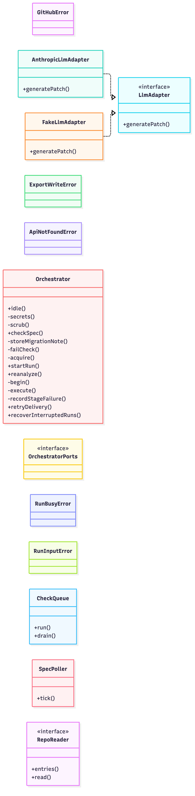
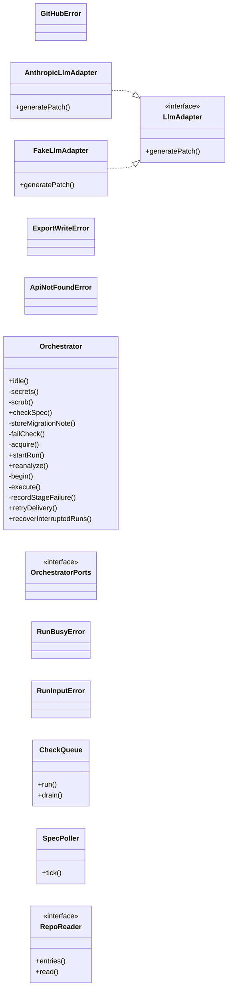

# Reverse-engineered exported classes and selected ports

<!-- Generated by npm run diagrams:reverse from the TypeScript AST. -->

| Declaration | Kind | Source |
| --- | --- | --- |
| GitHubError | class | [apps/server/src/infra/github/client.ts](../../apps/server/src/infra/github/client.ts) |
| AnthropicLlmAdapter | class | [apps/server/src/infra/llm/adapter.ts](../../apps/server/src/infra/llm/adapter.ts) |
| FakeLlmAdapter | class | [apps/server/src/infra/llm/fake.ts](../../apps/server/src/infra/llm/fake.ts) |
| LlmAdapter | interface | [apps/server/src/infra/llm/types.ts](../../apps/server/src/infra/llm/types.ts) |
| ExportWriteError | class | [apps/server/src/pipeline/export.ts](../../apps/server/src/pipeline/export.ts) |
| ApiNotFoundError | class | [apps/server/src/pipeline/ingest.ts](../../apps/server/src/pipeline/ingest.ts) |
| Orchestrator | class | [apps/server/src/pipeline/orchestrator.ts](../../apps/server/src/pipeline/orchestrator.ts) |
| OrchestratorPorts | interface | [apps/server/src/pipeline/orchestrator.ts](../../apps/server/src/pipeline/orchestrator.ts) |
| RunBusyError | class | [apps/server/src/pipeline/orchestrator.ts](../../apps/server/src/pipeline/orchestrator.ts) |
| RunInputError | class | [apps/server/src/pipeline/orchestrator.ts](../../apps/server/src/pipeline/orchestrator.ts) |
| CheckQueue | class | [apps/server/src/pipeline/poller.ts](../../apps/server/src/pipeline/poller.ts) |
| SpecPoller | class | [apps/server/src/pipeline/poller.ts](../../apps/server/src/pipeline/poller.ts) |
| RepoReader | interface | [packages/core/src/repo/limits.ts](../../packages/core/src/repo/limits.ts) |

The curated diagram includes function-based stage services, database entities and the React view.
This AST-derived diagram includes exported classes and selected adapter interfaces, with declared
methods and explicit implements relationships. It intentionally does not infer runtime dependency
injection, function-call relationships, database relationships, or UI components as classes.
