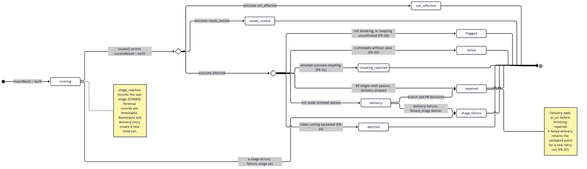
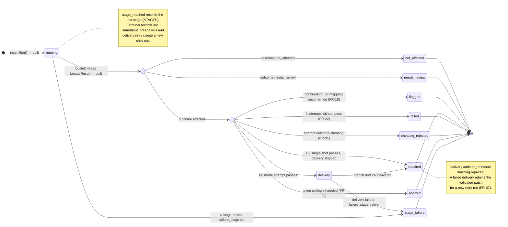
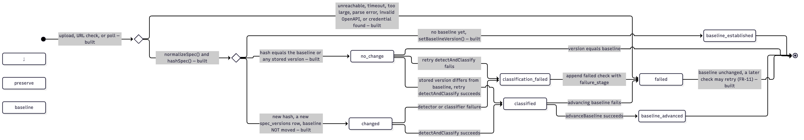
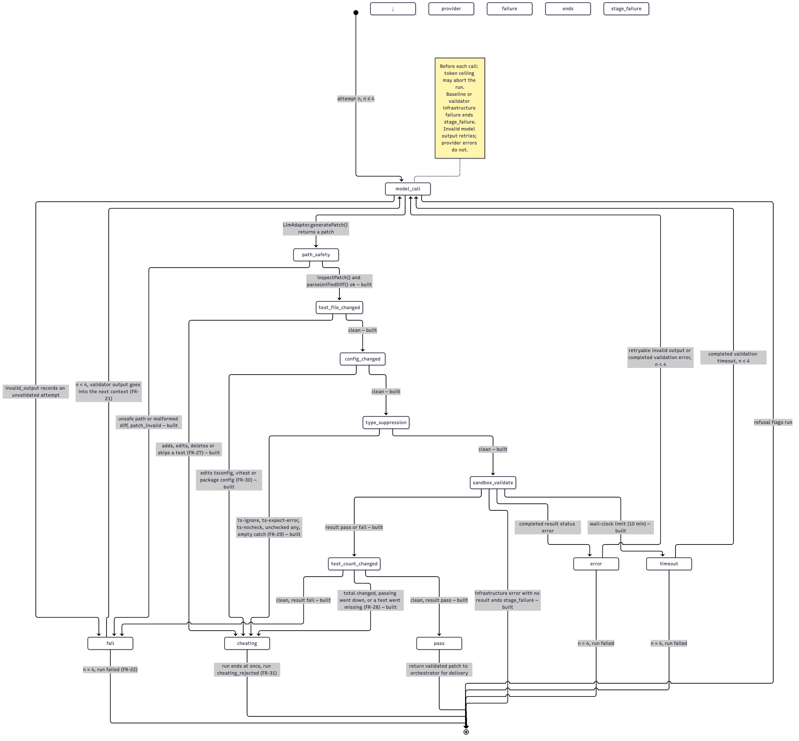

# Statecharts — Self-Maintaining APIs

Three UML statecharts, drawn as Mermaid `stateDiagram-v2`. The state names are the stored enum
values from [`packages/core/src/domain/enums.ts`](../../packages/core/src/domain/enums.ts), so the
charts use the same words as the database, the API, and the UI.

The orchestrator and repair loop are implemented. Activity and choice nodes are explicitly
listed separately from stored statuses; a delivery retry creates a new run.

`npm run docs:check` compares each chart with its enum. Every enum value must be a state in
the chart, and every state in the chart must be an enum value or a pseudo-state listed in that
chart's table.

---

## 1. Run lifecycle (`RUN_STATUSES`)

A run is one analysis of one change against one repository commit (`runs` table). It starts as
`running` and finishes in exactly one terminal status. The database enforces the frame:

- `runs_running_iff_unfinished`: the status is `running` exactly when `finished_at` is NULL.
- `runs_stage_failure_has_stage`: `stage_failure` must name a `failure_stage`.
- `runs_attempt_count_0_4`: at most 4 attempts (DR-03).
- Trigger `sma_runs_guard_update`: a finished run can't be updated. A reanalysis is a new run
  with `parent_run_id` (FR-39).

| State               | Kind         | Where it lives in the code                                                                                                                                                                    |
| ------------------- | ------------ | --------------------------------------------------------------------------------------------------------------------------------------------------------------------------------------------- |
| `running`           | RunStatus    | `packages/core/src/domain/enums.ts`; default of the `runStatusEnum` column in `apps/server/src/infra/db/schema.ts`                                                                            |
| `not_affected`      | RunStatus    | `packages/core/src/domain/enums.ts`; locator verdict in `packages/core/src/locate/locate.ts`                                                                                                  |
| `needs_review`      | RunStatus    | `packages/core/src/domain/enums.ts`; locator verdict in `packages/core/src/locate/locate.ts`                                                                                                  |
| `flagged`           | RunStatus    | `packages/core/src/domain/enums.ts`                                                                                                                                                           |
| `repaired`          | RunStatus    | `packages/core/src/domain/enums.ts`                                                                                                                                                           |
| `failed`            | RunStatus    | `packages/core/src/domain/enums.ts`                                                                                                                                                           |
| `aborted`           | RunStatus    | `packages/core/src/domain/enums.ts`                                                                                                                                                           |
| `cheating_rejected` | RunStatus    | `packages/core/src/domain/enums.ts`; `cheatingEndsRun` in `packages/core/src/guards/verdict.ts`                                                                                               |
| `stage_failure`     | RunStatus    | `packages/core/src/domain/enums.ts`; check `runs_stage_failure_has_stage` in `apps/server/src/infra/db/schema.ts`                                                                             |
| `locate_outcome`    | pseudo-state | Choice on `LocateResult.outcome` (`affected`, `not_affected`, `needs_review`) in `packages/core/src/locate/types.ts`                                                                          |
| `repair_gate`       | pseudo-state | Choice made by `repair` in `apps/server/src/pipeline/repair.ts`. `buildRepairContext` in `packages/core/src/repair/context.ts` already refuses a change that is not breaking or not confirmed |

| `delivery` | activity | `deliver` in `apps/server/src/pipeline/deliver.ts`; orchestrator finishes the run after delivery |

---

## 2. Spec check (`SPEC_CHECK_OUTCOMES`)

Every check (an upload, a URL retrieval, or a scheduled poll) writes one `spec_checks` row with
one outcome. `ingest()` in [`apps/server/src/pipeline/ingest.ts`](../../apps/server/src/pipeline/ingest.ts)
retrieves and parses the spec, then `decideCheckOutcome()` in
[`packages/core/src/ingest/spec.ts`](../../packages/core/src/ingest/spec.ts) picks the outcome.
All checks for one API run one at a time through `CheckQueue`, and `ingest()` locks the API row.
The flow combines ingestion and orchestration: detector/classifier failures append a separate
failed check rather than mutating the original ingestion row. A previously stored version that
differs from the baseline is classified again, so a failed check remains retryable.

```mermaid
stateDiagram-v2
  direction LR
  state retrieve_and_parse <<choice>>
  state compare_hash <<choice>>
  [*] --> retrieve_and_parse : upload, URL check, or poll — built
  retrieve_and_parse --> failed : unreachable, timeout, too large, parse error, invalid OpenAPI, or credential found — built
  retrieve_and_parse --> compare_hash : normalizeSpec() and hashSpec() — built
  compare_hash --> baseline_established : no baseline yet, setBaselineVersion() — built
  compare_hash --> no_change : hash equals the baseline or any stored version — built
  compare_hash --> changed : new hash, a new spec_versions row, baseline NOT moved — built
  failed --> [*] : baseline unchanged, a later check may retry (FR-11) — built
  baseline_established --> [*]
  no_change --> [*] : version equals baseline
  no_change --> classified : stored version differs from baseline, retry detectAndClassify succeeds
  no_change --> classification_failed : retry detectAndClassify fails
  changed --> classified : detectAndClassify succeeds
  classified --> baseline_advanced : advanceBaseline succeeds
  baseline_advanced --> [*]
  changed --> classification_failed : detector or classifier failure
  classification_failed --> failed : append failed check with failure_stage; preserve baseline
  classified --> failed : advancing baseline fails
```

| State                  | Kind             | Where it lives in the code                                                                                                                                                        |
| ---------------------- | ---------------- | --------------------------------------------------------------------------------------------------------------------------------------------------------------------------------- |
| `baseline_established` | SpecCheckOutcome | `packages/core/src/domain/enums.ts`; returned by `decideCheckOutcome` in `packages/core/src/ingest/spec.ts`                                                                       |
| `no_change`            | SpecCheckOutcome | `packages/core/src/domain/enums.ts`; returned by `decideCheckOutcome` in `packages/core/src/ingest/spec.ts`                                                                       |
| `changed`              | SpecCheckOutcome | `packages/core/src/domain/enums.ts`; returned by `decideCheckOutcome` in `packages/core/src/ingest/spec.ts`                                                                       |
| `failed`               | SpecCheckOutcome | `packages/core/src/domain/enums.ts`; set by `ingest` in `apps/server/src/pipeline/ingest.ts`; check `spec_checks_failed_has_error_detail` in `apps/server/src/infra/db/schema.ts` |
| `retrieve_and_parse`   | pseudo-state     | `retrieveSpec` in `apps/server/src/infra/spec-source/retrieve.ts`, `parseSpec` in `packages/core/src/ingest/spec.ts`                                                              |
| `compare_hash`         | pseudo-state     | `decideCheckOutcome` in `packages/core/src/ingest/spec.ts`                                                                                                                        |

| `classified` | activity | `detectAndClassify` in `apps/server/src/pipeline/classify.ts` |
| `baseline_advanced` | activity | `advanceBaseline` in `apps/server/src/pipeline/orchestrator.ts` |
| `classification_failed` | activity | `failCheck` in `apps/server/src/pipeline/orchestrator.ts`; appends a failed check and retains the earlier ingest row |

---

## 3. Repair attempt loop (`ATTEMPT_OUTCOMES`, guard order)

One attempt is: get a patch from the model, run the guards, and validate the patch in the
sandbox. `guardedValidate()` in
[`apps/server/src/pipeline/guarded-validate.ts`](../../apps/server/src/pipeline/guarded-validate.ts)
handles validation for one patch. [`repair`](../../apps/server/src/pipeline/repair.ts)
wraps it with the eligibility gate, pre-patch baseline, token budget and up to four attempts.
The diagram shows full mode; B2 single-shot deliberately bypasses the guards.

The guards run in the fixed order `GUARD_ORDER` from
[`packages/core/src/guards/verdict.ts`](../../packages/core/src/guards/verdict.ts):
**test_file_changed → config_changed → type_suppression → test_count_changed**.
The first three are static: they read only the diff and the post-patch text, so a cheating
patch is rejected **before the container ever runs**. The count guard compares the test counts
before and after the patch, so it needs the validation result.

```mermaid
stateDiagram-v2
  direction TB
  [*] --> model_call : attempt n, n ≤ 4
  model_call --> fail : invalid_output records an unvalidated attempt
  model_call --> path_safety : LlmAdapter.generatePatch() returns a patch
  path_safety --> fail : unsafe path or malformed diff, patch_invalid — built
  path_safety --> test_file_changed : inspectPatch() and parseUnifiedDiff() ok — built
  test_file_changed --> cheating : adds, edits, deletes or skips a test (FR-27) — built
  test_file_changed --> config_changed : clean — built
  config_changed --> cheating : edits tsconfig, vitest or package config (FR-30) — built
  config_changed --> type_suppression : clean — built
  type_suppression --> cheating : ts-ignore, ts-expect-error, ts-nocheck, unchecked any, empty catch (FR-29) — built
  type_suppression --> sandbox_validate : clean — built
  sandbox_validate --> error : completed result status error
  sandbox_validate --> [*] : infrastructure error with no result ends stage_failure — built
  sandbox_validate --> timeout : wall-clock limit (10 min) — built
  sandbox_validate --> test_count_changed : result pass or fail — built
  test_count_changed --> cheating : total changed, passing went down, or a test went missing (FR-28) — built
  test_count_changed --> pass : clean, result pass — built
  test_count_changed --> fail : clean, result fail — built
  cheating --> [*] : run ends at once, run cheating_rejected (FR-31)
  pass --> [*] : return validated patch to orchestrator for delivery
  fail --> model_call : n < 4, validator output goes into the next context (FR-21)
  error --> model_call : retryable invalid output or completed validation error, n < 4
  timeout --> model_call : completed validation timeout, n < 4
  fail --> [*] : n = 4, run failed (FR-22)
  error --> [*] : n = 4, run failed
  timeout --> [*] : n = 4, run failed
  model_call --> [*] : refusal flags run; provider failure ends stage_failure
  note left of model_call
    Before each call: token ceiling may abort the run.
    Baseline or validator infrastructure failure ends stage_failure.
    Invalid model output retries; provider errors do not.
  end note
```

| State                | Kind           | Where it lives in the code                                                                                           |
| -------------------- | -------------- | -------------------------------------------------------------------------------------------------------------------- |
| `pass`               | AttemptOutcome | `packages/core/src/domain/enums.ts`; returned by `guardedValidate` in `apps/server/src/pipeline/guarded-validate.ts` |
| `fail`               | AttemptOutcome | `packages/core/src/domain/enums.ts`; returned by `guardedValidate` in `apps/server/src/pipeline/guarded-validate.ts` |
| `cheating`           | AttemptOutcome | `packages/core/src/domain/enums.ts`; check `attempts_cheating_iff_guard` in `apps/server/src/infra/db/schema.ts`     |
| `error`              | AttemptOutcome | `packages/core/src/domain/enums.ts`; returned by `guardedValidate` in `apps/server/src/pipeline/guarded-validate.ts` |
| `timeout`            | AttemptOutcome | `packages/core/src/domain/enums.ts`; validation status `timeout` in `packages/core/src/validate/types.ts`            |
| `test_file_changed`  | guard step     | `GUARD_NAMES` in `packages/core/src/domain/enums.ts`; `testFileGuard` in `packages/core/src/guards/static.ts`        |
| `config_changed`     | guard step     | `GUARD_NAMES` in `packages/core/src/domain/enums.ts`; `configGuard` in `packages/core/src/guards/static.ts`          |
| `type_suppression`   | guard step     | `GUARD_NAMES` in `packages/core/src/domain/enums.ts`; `typeSuppressionGuard` in `packages/core/src/guards/static.ts` |
| `test_count_changed` | guard step     | `GUARD_NAMES` in `packages/core/src/domain/enums.ts`; `countGuard` in `packages/core/src/guards/count.ts`            |
| `model_call`         | activity       | `generatePatch` of `LlmAdapter` in `apps/server/src/infra/llm/types.ts`                                              |
| `path_safety`        | activity       | `inspectPatch` in `packages/core/src/validate/patch.ts`, `parseUnifiedDiff` in `packages/core/src/guards/diff.ts`    |
| `sandbox_validate`   | activity       | `validate` in `apps/server/src/pipeline/validate.ts`                                                                 |
